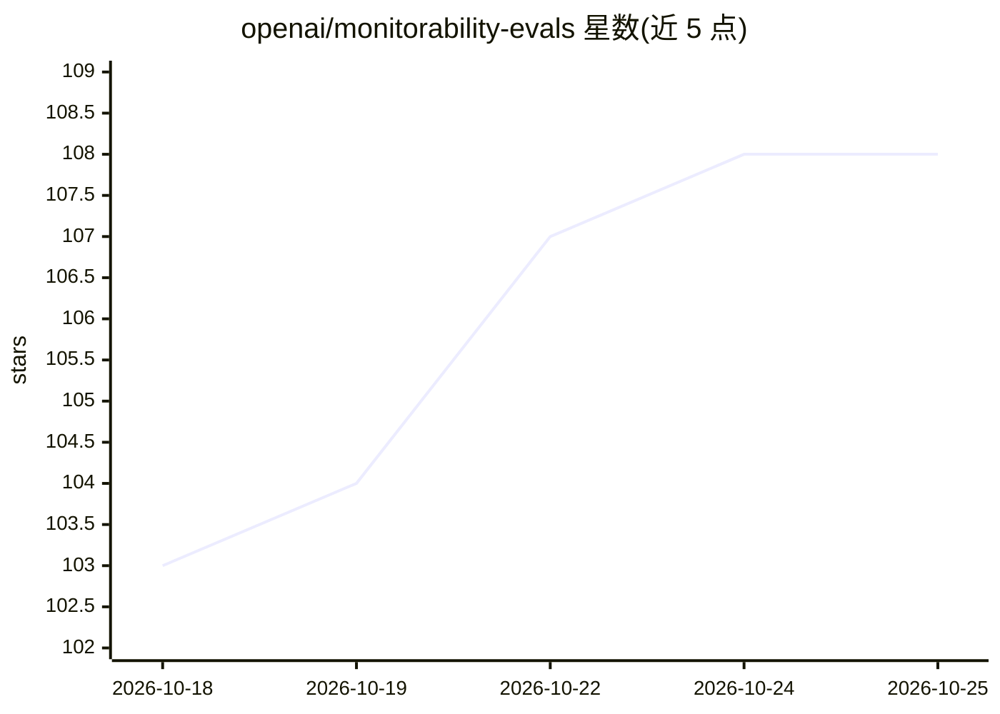

# openai/monitorability-evals

⭐ 108 · Python · Apache-2.0 · 推送 2026-08-17 · [GitHub](https://github.com/openai/monitorability-evals) · 组织维护

**Monitoring Monitorability 论文的公开评测数据集**

OpenAI 发布的监测能力评测数据集，对应 Monitoring Monitorability 论文的公开切分。数据按三种原型组织：Intervention（11 个中开源 9 个，含 perturbed/unperturbed 成对行与扰动文本）、Process（4 个中开源 2 个，含定理路径与定义）、Outcome-property（开源 Flaky Tools 的 CharXcv 子集）。不含 AIME 题面本身，仅提供 url/source 字段链接外部来源；依赖私有数据的评测未放出。另含监测与模型 prompt 模板目录及 dataset_registry.yaml 映射，Apache-2.0 许可。Anti-Scheming 与 Memory 两个评测因存在问题已声明停用。

## 筛选速览

| 维度 | 判定 | 备注 |
|---|---|---|
| AI 角色 | `ai-knowledge` | 知识聚合/清单类 |
| 许可风险 | `permissive` | Apache-2.0 |
| 部署形态 | `None` |  |
| 模型依赖 | — | README 未给出锁定关系 |
| 硬件要求 | — | 无带数字的原话,不猜 |
| 安装摩擦 | `low` | 无编译、无系统依赖或容器化 |
| 成熟度 | — | 结构信号不足 |

## 能力要点

- 三种评测原型：Intervention/Process/Outcome-property
- perturbed/unperturbed 成对行设计用于指标计算
- 提供监测与模型 prompt 模板及 dataset_registry.yaml 标签映射
- AIME 题面因版权仅以 url/source 字段外链

## 适用场景

- 研究模型监测器在扰动、过程与结果属性上的可监测性
- 复现 Monitoring Monitorability 论文的评测切分
- 为安全评测构建使用现成的 prompt 模板与标签语义

## 场景标签

`模型评测` · 领域:评测与运维

## 证据(README 行号)

> L3: Open-sourced evaluation data from the Monitoring Monitorability paper. This contains the public evaluation split. Fo
> L7: There are three archetypes:

## 星数曲线

2026-10-18 103 → 2026-10-25 108（+5）

---
*卡片 v1 · prompt 1.4 · 生成 2026-10-23 · 置信度 high · 依据 README sha `3dd4dea7feb8` · [字段定义](../../DATASET.md)*
