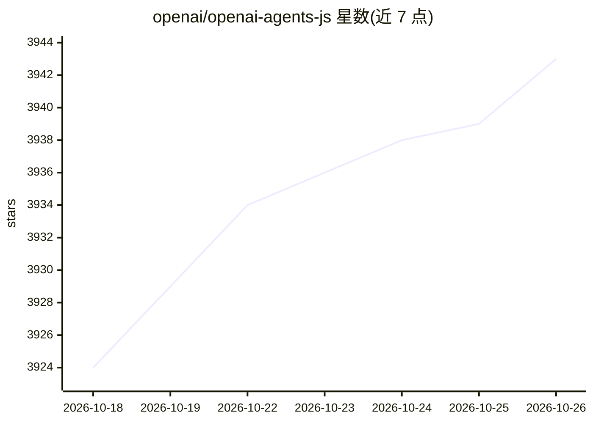

# openai/openai-agents-js

⭐ 3,943 · TypeScript · MIT · 推送 2026-10-23 · [GitHub](https://github.com/openai/openai-agents-js) · [官网](https://openai.github.io/openai-agents-js/) · 组织维护

**OpenAI 官方的 JS/TS 多 Agent 与语音 Agent 开发框架**

OpenAI 维护的 JavaScript/TypeScript Agent 开发框架，声明 provider-agnostic，支持 OpenAI API 及其他提供商。核心概念包括：带指令/工具/护栏/交接的 Agent、绑定文件系统工作区的沙箱 Agent（macOS/Linux 用 UnixLocalSandboxClient，Windows 用 DockerSandboxClient）、面向语音的低延迟 Realtime Agent，以及工具调用（函数/MCP/托管工具）、护栏、Human-in-the-loop、会话历史与内置 Tracing。运行环境需 Node.js 22+、Deno 或 Bun，Cloudflare Workers 为实验性支持。文本与沙箱 Agent 需设置 OPENAI_API_KEY，浏览器端 Realtime Agent 需服务端签发临时 token。

## 筛选速览

| 维度 | 判定 | 备注 |
|---|---|---|
| AI 角色 | `ai-ecosystem` | LLM/agent 周边工具 |
| 许可风险 | `permissive` | MIT |
| 部署形态 | `library` | 以包/库形式分发 |
| 模型依赖 | — | README 未给出锁定关系 |
| 硬件要求 | — | 无带数字的原话,不猜 |
| 安装摩擦 | `low` | 无编译、无系统依赖或容器化 |
| 成熟度 | `idea` | |

## 能力要点

- Agent/沙箱 Agent/Realtime Agent 三类 Agent 抽象
- 工具调用支持函数、MCP 与托管工具
- 内置护栏、Human-in-the-loop、会话管理与 Tracing
- 声明 provider-agnostic，支持 OpenAI API 及更多提供商

## 适用场景

- 用 TypeScript 构建 LLM 多 Agent 工作流
- 开发带文件系统沙箱与命令执行的长时间任务 Agent
- 在浏览器中构建低延迟语音交互 Agent

## 场景标签

`Agent 框架` `多智能体` · 领域:Agent 开发

## 证据(README 行号)

> L5: The OpenAI Agents SDK is a lightweight yet powerful framework for building multi-agent workflows in JavaScript/TypeS
> L13: 1. **Realtime Agents**: Low-latency agents for spoken interactions, with tools, guardrails, handoffs, and conversat

## 星数曲线

2026-10-18 3,924 → 2026-10-26 3,943（+19）

---
*卡片 v1 · prompt 1.4 · 生成 2026-10-20 · 置信度 high · 依据 README sha `00544b3accdc` · [字段定义](../../DATASET.md)*
