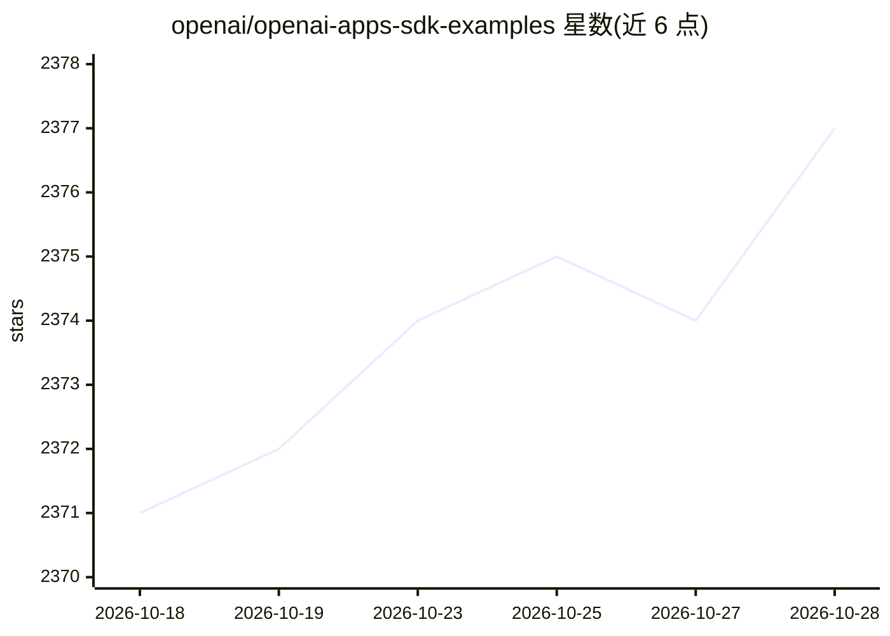

# openai/openai-apps-sdk-examples

⭐ 2,377 · TypeScript · MIT · 推送 2026-04-15 · [GitHub](https://github.com/openai/openai-apps-sdk-examples) · 组织维护

**ChatGPT Apps SDK 官方示例集：widget 组件与 MCP 服务器**

OpenAI 维护的 Apps SDK 示例仓库，展示可与 ChatGPT 配合使用的 UI widget 组件及将组件以工具形式暴露的示例 MCP 服务器，覆盖 Node 与 Python 实现。示例包括 Pizzaz、3D 太阳系查看器、带 OAuth 认证的工具、kitchen-sink-lite 与购物车 widget，演示 widgetState 同步、callTool、宿主 API 等机制。构建基于 Vite 产出静态 bundle，由本地静态服务器供 MCP 服务器引用，可通过 ngrok 接入 ChatGPT Connectors 测试。限制：Chrome 142 需禁用 local-network-access flag 才能查看 widget UI。

## 筛选速览

| 维度 | 判定 | 备注 |
|---|---|---|
| AI 角色 | `ai-ecosystem` | LLM/agent 周边工具 |
| 许可风险 | `permissive` | MIT |
| 部署形态 | `library` | 以包/库形式分发 |
| 模型依赖 | — | README 未给出锁定关系 |
| 硬件要求 | — | 无带数字的原话,不猜 |
| 安装摩擦 | `low` | 无编译、无系统依赖或容器化 |
| 成熟度 | — | 结构信号不足 |

## 能力要点

- 多个 widget 示例组件与配套 Node/Python MCP 服务器
- 演示 widgetSessionId 跨轮次同步 widgetState
- 演示 OAuth 认证工具调用与 callTool、宿主状态读写
- Vite 构建产出独立 HTML/JS/CSS bundle 供服务器复用

## 适用场景

- 作为开发 ChatGPT Apps 应用的起点与参考实现
- 学习 MCP 工具返回内联 widget 的实现方式
- 本地起 MCP 服务器并通过 ngrok 接入 ChatGPT 测试

## 场景标签

`Agent 框架` `教程课程` · 领域:Agent 开发

## 证据(README 行号)

> L5: This repository showcases example UI components to be used with the Apps SDK, as well as example MCP servers that ex
> L20: The Model Context Protocol (MCP) is an open specification for connecting large language model clients to external t

## 星数曲线

2026-10-18 2,371 → 2026-10-28 2,377（+6）

---
*卡片 v1 · prompt 1.4 · 生成 2026-10-21 · 置信度 mid · 依据 README sha `5d061540cd21` · [字段定义](../../DATASET.md)*
