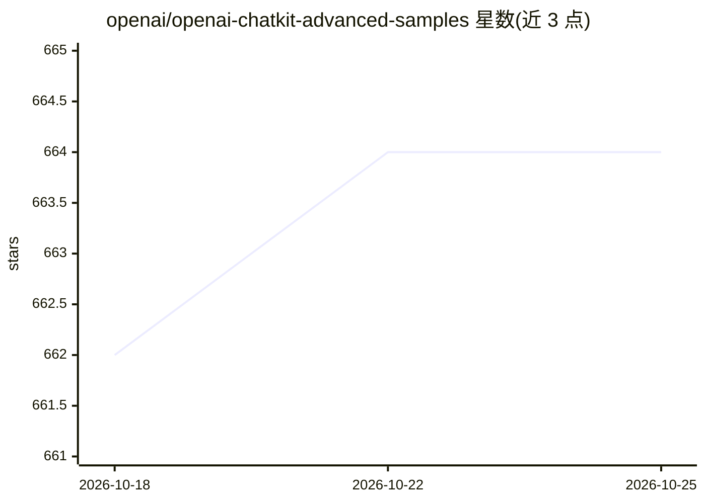

# openai/openai-chatkit-advanced-samples

⭐ 664 · NOASSERTION · 推送 2026-08-01 · [GitHub](https://github.com/openai/openai-chatkit-advanced-samples) · [官网](https://platform.openai.com/docs/guides/chatkit) · 组织维护

**OpenAI ChatKit SDK 的场景化示例应用集合（4 个可运行 demo）**

OpenAI 官方维护的 ChatKit 示例仓库，含 Cat Lounge 虚拟宠物、Customer Support 航空客服、News Guide 新闻助手、Metro Map 地铁规划四个示例。每个示例由 FastAPI 后端（ChatKit Python SDK）与 Vite + React 前端（ChatKit.js）组成，演示服务端工具调用、客户端工具、fire-and-forget 效果、带/不带动作的 widget、附件上传、语音听写、@-mentions、composer 命令、线程标题、图像生成等能力。需导出 OPENAI_API_KEY 并安装 uv，通过 npm 命令启动。

## 筛选速览

| 维度 | 判定 | 备注 |
|---|---|---|
| AI 角色 | `ai-ecosystem` | LLM/agent 周边工具 |
| 许可风险 | `none` | NOASSERTION |
| 部署形态 | `library` | 以包/库形式分发 |
| 模型依赖 | — | README 未给出锁定关系 |
| 硬件要求 | — | 无带数字的原话,不猜 |
| 安装摩擦 | `low` | 无编译、无系统依赖或容器化 |
| 成熟度 | — | 结构信号不足 |

## 能力要点

- 每个示例配 FastAPI 后端 + Vite/React 前端
- 覆盖服务端/客户端工具调用、widget 动作、附件、听写、@-mentions 等 ChatKit 特性
- 四个场景 demo：虚拟宠物、航空客服、新闻助手、地铁规划
- 演示流式进度更新、线程标题与图像生成

## 适用场景

- 基于 ChatKit SDK 构建自己的对话应用时参考实现
- 学习服务端工具与客户端 widget/效果的开发模式
- 搭建带附件、听写、@-mentions 的客服或助手原型

## 场景标签

`聊天机器人` `AI 助手` · 领域:对话与助手

## 证据(README 行号)

> L1: # OpenAI ChatKit Examples
> L3: This repository collects scenario-driven ChatKit demos. Each example pairs a FastAPI backend with a Vite + React fro

## 星数曲线

2026-10-18 662 → 2026-10-25 664（+2）

---
*卡片 v1 · prompt 1.4 · 生成 2026-10-21 · 置信度 high · 依据 README sha `7bac29e30c45` · [字段定义](../../DATASET.md)*
