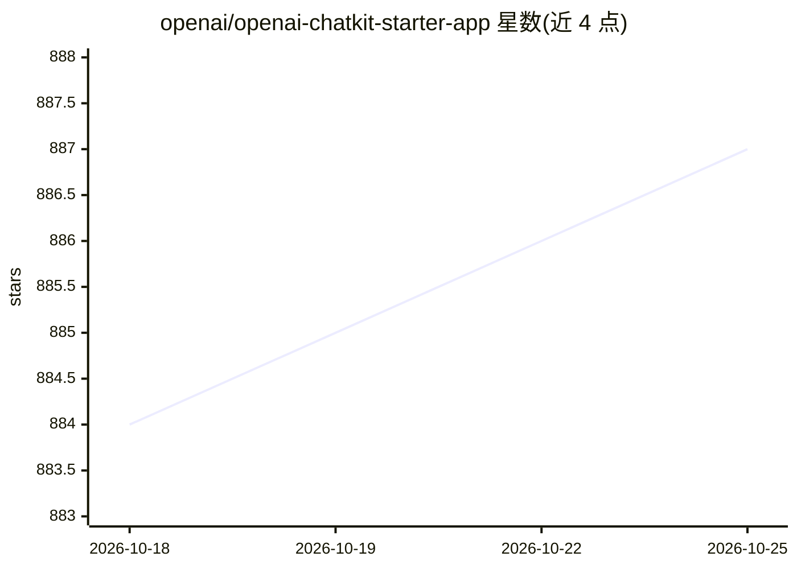

# openai/openai-chatkit-starter-app

⭐ 886 · Python · MIT · 推送 2026-03-27 · [GitHub](https://github.com/openai/openai-chatkit-starter-app) · [官网](https://platform.openai.com/docs/guides/chatkit) · 组织维护

**OpenAI ChatKit 集成的入门示例应用模板**

提供两个入门应用作为最小化 ChatKit 集成的参考实现：一个展示自托管 ChatKit 集成方式，另一个展示带托管工作流的 Managed ChatKit 集成方式。面向希望基于 OpenAI ChatKit 与 Agent Builder 搭建聊天界面的开发者，作为集成起点与参考代码。README 未给出具体安装命令，细节需进入各示例目录查看。

## 筛选速览

| 维度 | 判定 | 备注 |
|---|---|---|
| AI 角色 | `ai-ecosystem` | LLM/agent 周边工具 |
| 许可风险 | `permissive` | MIT |
| 部署形态 | `None` |  |
| 模型依赖 | — | README 未给出锁定关系 |
| 硬件要求 | — | 无带数字的原话,不猜 |
| 安装摩擦 | `low` | 无编译、无系统依赖或容器化 |
| 成熟度 | — | 结构信号不足 |

## 能力要点

- 包含 ChatKit 自托管集成示例
- 包含 Managed ChatKit 托管工作流集成示例

## 适用场景

- 开发者参考最小集成方式接入 OpenAI ChatKit
- 基于模板起步搭建带托管工作流的聊天应用

## 场景标签

`聊天机器人` · 领域:对话与助手

## 证据(README 行号)

> L3: This repository contains two starter apps as reference implementations of minimal ChatKit integrations.
> L7: - **ChatKit** - example of a self-hosted ChatKit integration.
> L8: - **Managed ChatKit** – example of a managed ChatKit integration with hosted workflows.

## 星数曲线

2026-10-18 884 → 2026-10-25 887（+3）

---
*卡片 v1 · prompt 1.4 · 生成 2026-10-21 · 置信度 mid · 依据 README sha `d103dc99748a` · [字段定义](../../DATASET.md)*
