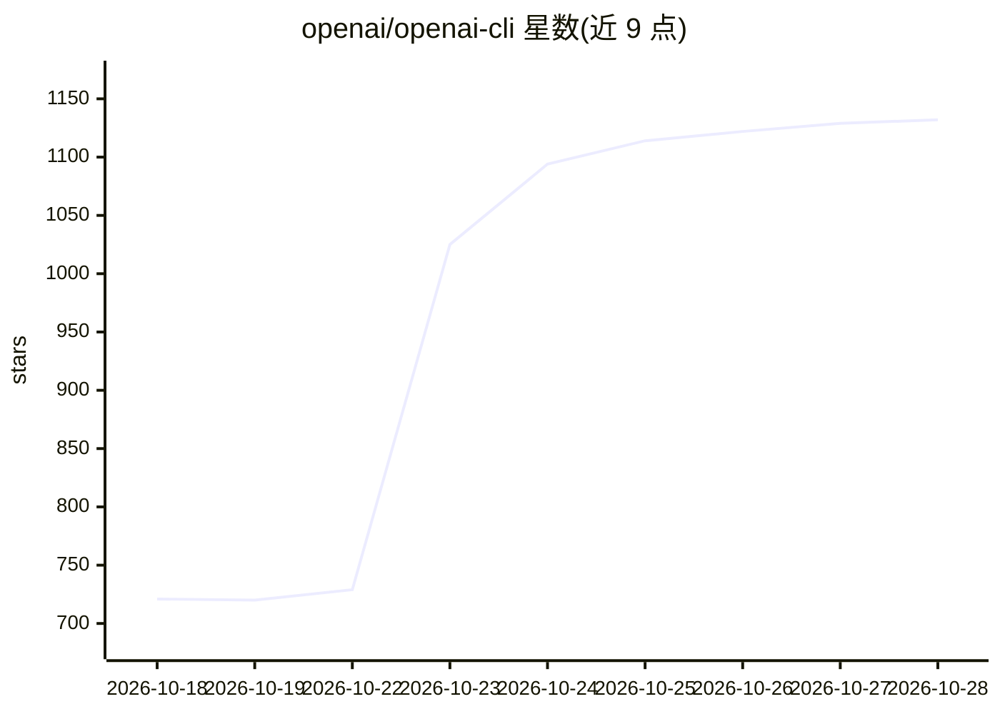

# openai/openai-cli

⭐ 1,137 · Go · Apache-2.0 · 推送 2026-10-28 · [GitHub](https://github.com/openai/openai-cli) · 组织维护

**OpenAI REST API 官方命令行客户端**

OpenAI 官方维护的 CLI，用资源式命令结构调用 OpenAI REST API：创建 responses、生成并保存图像、上传下载文件、查询组织用量等；支持标准 API key 与 Admin key 两种认证，以及 mTLS 客户端证书（beta）。输出格式可选 text/json/jsonl/yaml 等，支持 GJSON 语法的数据转换、自定义请求头、base-url 指向后端、Tab 补全与本地文件作为参数（含不可信 stdin 模式）。面向在终端或脚本中调用 OpenAI API 的开发者。

## 筛选速览

| 维度 | 判定 | 备注 |
|---|---|---|
| AI 角色 | `ai-ecosystem` | LLM/agent 周边工具 |
| 许可风险 | `permissive` | Apache-2.0 |
| 部署形态 | `library` | 以包/库形式分发 |
| 模型依赖 | — | README 未给出锁定关系 |
| 硬件要求 | — | 无带数字的原话,不猜 |
| 安装摩擦 | `low` | 无编译、无系统依赖或容器化 |
| 成熟度 | — | 结构信号不足 |

## 能力要点

- 资源式命令结构覆盖标准 API 与 Admin 端点（responses/images/files/admin 等）
- 多输出格式（json/jsonl/yaml/raw 等）与 GJSON 语法的 --transform 数据提取
- mTLS 客户端证书认证（beta）与自定义请求头、base-url 自定义后端
- 图像生成自动保存到 ~/Downloads/gpt-images/ 并打印路径

## 适用场景

- 在终端或脚本中调用 OpenAI API 完成对话与图像生成
- 上传、查询并下载 OpenAI 文件资源
- 用 Admin key 查询组织与项目的用量统计
- 以 --format json 与 --transform 提取数据用于自动化流水线

## 场景标签

`图像生成` · 领域:内容生成

## 证据(README 行号)

> L3: The official CLI for the OpenAI REST API.
> L53: openai <resource> [subresource...] <command> [flags...]

## 星数曲线

2026-10-18 721 → 2026-10-28 1,132（+411）

---
*卡片 v1 · prompt 1.4 · 生成 2026-10-21 · 置信度 high · 依据 README sha `6d4dfa6ff9f5` · [字段定义](../../DATASET.md)*
