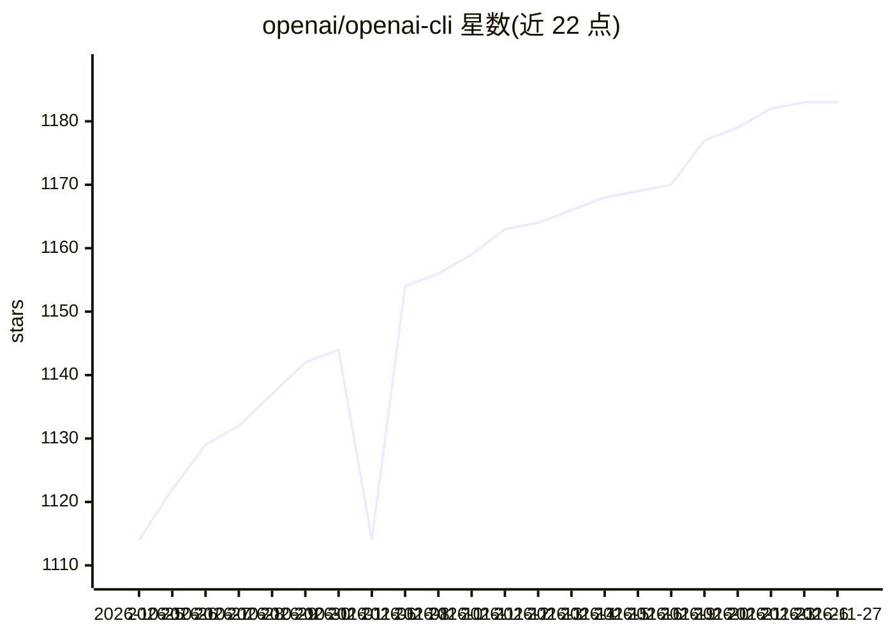

# openai/openai-cli

⭐ 1,183 · Go · Apache-2.0 · 推送 2026-11-26 · [GitHub](https://github.com/openai/openai-cli) · 组织维护

**OpenAI API 的官方命令行工具**

OpenAI 官方发布的命令行工具，用于从终端调用 OpenAI REST API，命令结构跟随 API 资源组织，覆盖 responses、images、files、batches、vector stores、audio 等端点。支持自然语言探索命令（无需 API key）、多格式输出（text/json/jsonl/yaml/raw）、GJSON 字段提取、HTTP 调试、shell 补全与本地 tokenizer。提供 Homebrew、预编译二进制（macOS/Linux/Windows）、Go install 及 Linux 发行版包多种安装方式，默认手动升级。另提供可选的 agent 技能，供 Codex、Claude Code 等 shell agent 调用。

## 筛选速览

| 维度 | 判定 | 备注 |
|---|---|---|
| AI 角色 | `ai-ecosystem` | LLM/agent 周边工具 |
| 许可风险 | `permissive` | Apache-2.0 |
| 部署形态 | `desktop` | 安装包/桌面程序 |
| 模型依赖 | — | README 未给出锁定关系 |
| 硬件要求 | — | 无带数字的原话,不猜 |
| 安装摩擦 | `low` | 无编译、无系统依赖或容器化 |
| 成熟度 | — | 结构信号不足 |

## 能力要点

- 命令按 API 资源组织，覆盖 responses/images/files/batches/vector stores/audio 等
- openai explore 支持自然语言描述查找命令，无需 API key
- 输出格式可选 text/json/jsonl/yaml/raw，支持 --transform GJSON 提取字段
- 提供 CLI skill 供 Codex/Claude Code/Cursor 等编码 agent 安装使用

## 适用场景

- 在终端和脚本中直接调用 OpenAI API 发送请求、生成图像
- 上传文件并创建批处理任务，下载批处理结果
- 从 shell 导出 API 数据（模型列表、文件列表）给脚本处理
- 为编码 agent 配置 OpenAI API 命令使用技能

## 场景标签

 · 领域:开发者工具/API 客户端

## 证据(README 行号)

> L3:  The official command-line tool for the OpenAI REST API.
> L152: openai <resource> [subresource...] <command> [flags...]

## 星数曲线

2026-10-25 1,114 → 2026-11-27 1,183（+69）

---
*卡片 v1 · prompt 1.4 · 生成 2026-11-25 · 置信度 high · 依据 README sha `c48f85537504` · [字段定义](../../DATASET.md)*
