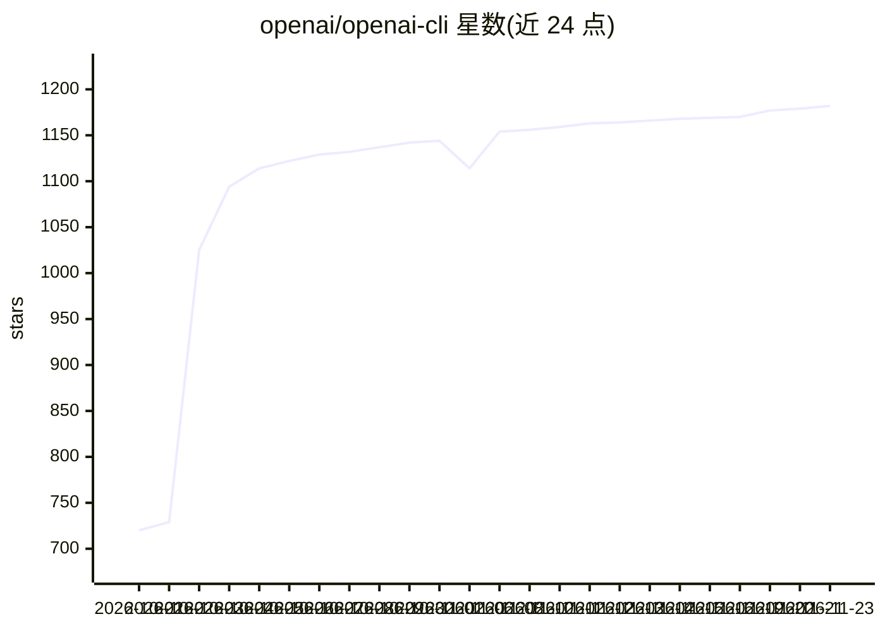

# openai/openai-cli

⭐ 1,182 · Go · Apache-2.0 · 推送 2026-11-22 · [GitHub](https://github.com/openai/openai-cli) · 组织维护

**开发者的 OpenAI API 官方命令行工具**

OpenAI 官方发布的命令行工具，按 API 资源组织命令，覆盖 responses/chat completions、图像生成、文件上传下载、批量请求、向量库、音频、本地分词计数等端点操作。安装方式包括预编译二进制、Linux 包管理器、Homebrew 与 go install。支持 OPENAI_API_KEY/OPENAI_ADMIN_KEY 认证、json/jsonl/yaml 输出格式、GJSON 字段提取、调试日志与 shell 补全，另提供可装入 Codex/Claude Code 等编码 agent 的 CLI skill。不含编码 agent 本身。

## 筛选速览

| 维度 | 判定 | 备注 |
|---|---|---|
| AI 角色 | `ai-ecosystem` | LLM/agent 周边工具 |
| 许可风险 | `permissive` | Apache-2.0 |
| 部署形态 | `desktop` | 安装包/桌面程序 |
| 模型依赖 | — | README 未给出锁定关系 |
| 硬件要求 | — | 无带数字的原话,不猜 |
| 安装摩擦 | `low` | 无编译、无系统依赖或容器化 |
| 成熟度 | — | 结构信号不足 |

## 能力要点

- 覆盖 responses/images/files/batches/vector stores/audio 等 API 资源的命令
- 本地离线分词计数与 explore 命令搜索（无需 API key）
- json/jsonl/yaml/raw 输出与 GJSON --transform 字段提取
- 可安装到 Codex/Claude Code/Cursor 等 agent 的 CLI skill

## 适用场景

- 在终端直接调用 OpenAI API 生成文本或图像
- 用 JSONL 提交批量请求并下载结果
- 脚本中导出 API 数据做自动化处理
- 为编码 agent 配置 OpenAI API 命令使用技能

## 场景标签

 · 领域:开发工具/API 客户端

## 证据(README 行号)

> L3:  The official command-line tool for the OpenAI REST API.
> L15: > Looking for the coding agent? Use Codex CLI.
> L255: ## Use the CLI from a coding agent

## 星数曲线

2026-10-21 720 → 2026-11-23 1,182（+462）

---
*卡片 v1 · prompt 1.4 · 生成 2026-11-23 · 置信度 high · 依据 README sha `204f528510d9` · [字段定义](../../DATASET.md)*
