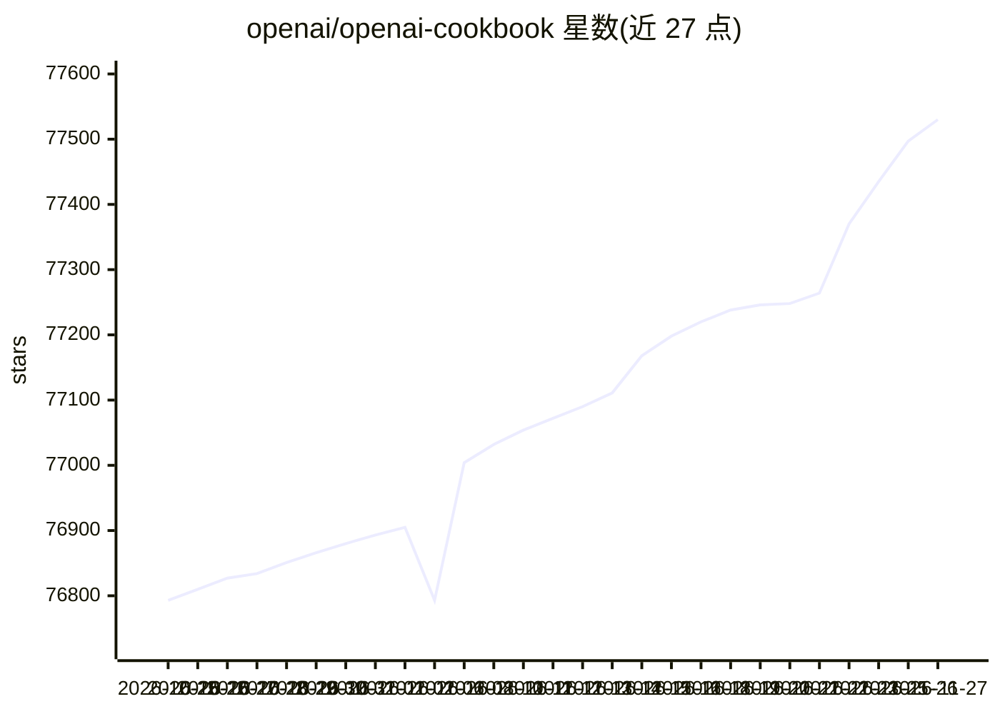

# openai/openai-cookbook

⭐ 77,530 · Jupyter Notebook · MIT · 推送 2026-11-25 · [GitHub](https://github.com/openai/openai-cookbook) · [官网](https://cookbook.openai.com) · 组织维护

**面向 OpenAI API 用户的示例代码与任务指南合集**

OpenAI 官方 Cookbook 仓库，提供使用 OpenAI API 完成常见任务的示例代码与指南，以 notebook 形式组织，配套站点 cookbook.openai.com 提供导航。运行示例需要 OpenAI 账号与 API key，通过 OPENAI_API_KEY 环境变量或 .env 文件配置。示例大多以 Python 编写，概念可迁移到其他语言。仓库采用 MIT 许可证，并收录来自社区的相关工具、指南与课程资源链接。

## 筛选速览

| 维度 | 判定 | 备注 |
|---|---|---|
| AI 角色 | `ai-knowledge` | 知识聚合/清单类 |
| 许可风险 | `permissive` | MIT |
| 部署形态 | `None` |  |
| 模型依赖 | — | README 未给出锁定关系 |
| 硬件要求 | — | 无带数字的原话,不猜 |
| 安装摩擦 | `low` | 无编译、无系统依赖或容器化 |
| 成熟度 | — | 结构信号不足 |

## 动量与使用信号

- 维护:`active` — 距上次 push 1.3 天,年发版 0,376 位贡献者
- 涨星:近 1 天 **+28**(自 20261016 起算)
- 平台:— · 协议:OPENAI-API

## 能力要点

- 提供 OpenAI API 常见任务的示例代码与指南
- 配套 cookbook.openai.com 站点导航
- API key 通过环境变量或 .env 文件配置
- 示例以 Python 为主，概念适用于任意语言

## 适用场景

- 查找用 OpenAI API 完成某类任务的参考示例
- 按官方指南学习 API 的使用方式
- 复制 notebook 代码到自己的项目改造使用

## 场景标签

`教程课程` · 领域:学习与行业

## 证据(README 行号)

> L6: Example code and guides for accomplishing common tasks with the OpenAI API. To run these examples, you'll need an Op
> L10: For other useful tools, guides and courses, check out these related resources from around the web.

## 星数曲线

2026-10-25 76,793 → 2026-11-27 77,530（+737）

---
*卡片 v1 · prompt 1.4 · 生成 2026-11-22 · 置信度 high · 依据 README sha `55ac3ebe9e86` · [字段定义](../../DATASET.md)*
