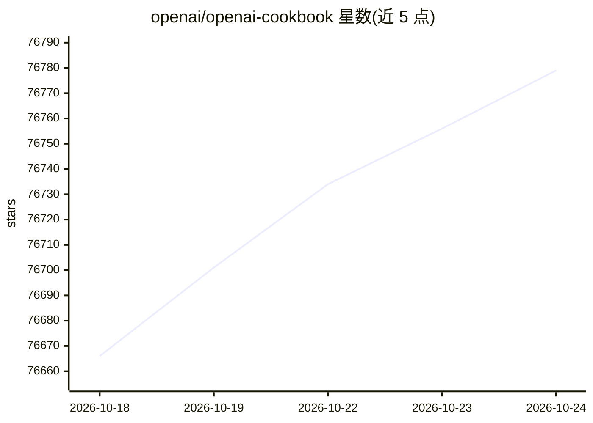

# openai/openai-cookbook

⭐ 76,793 · Jupyter Notebook · MIT · 推送 2026-10-23 · [GitHub](https://github.com/openai/openai-cookbook) · [官网](https://cookbook.openai.com) · 组织维护

**为 OpenAI API 使用者提供示例代码与任务指南**

OpenAI 官方维护的示例代码与指南合集，覆盖使用 OpenAI API 完成常见任务的方法。示例以 Python 为主，概念可迁移到其他语言。运行示例需要 OpenAI 账号与 API key，通过 OPENAI_API_KEY 环境变量或 .env 文件配置。内容在 cookbook.openai.com 提供导航，项目采用 MIT 许可证。

## 筛选速览

| 维度 | 判定 | 备注 |
|---|---|---|
| AI 角色 | `ai-ecosystem` | LLM/agent 周边工具 |
| 许可风险 | `permissive` | MIT |
| 部署形态 | `None` |  |
| 模型依赖 | — | README 未给出锁定关系 |
| 硬件要求 | — | 无带数字的原话,不猜 |
| 安装摩擦 | `low` | 无编译、无系统依赖或容器化 |
| 成熟度 | — | 结构信号不足 |

## 动量与使用信号

- 维护:`active` — 距上次 push 1.3 天,年发版 0,376 位贡献者
- 涨星:近 1 天 **+28**(自 20261016 起算)
- 平台:— · 协议:OPENAI-API

## 能力要点

- 常见任务的示例代码与指南合集
- 示例以 Python 为主，概念可应用于其他语言
- 通过 OPENAI_API_KEY 环境变量或 .env 文件配置密钥
- MIT 许可证开源

## 适用场景

- 查阅 OpenAI API 完成常见任务的示例代码
- 为其他编程语言移植 API 使用概念提供参考
- 搭建本地环境运行官方示例 notebook

## 场景标签

`教程课程` · 领域:学习与行业

## 证据(README 行号)

> L9: Example code and guides for accomplishing common tasks with the OpenAI API. To run these examples, you'll need an Op
> L11: Most code examples are written in Python, though the concepts can be applied in any language.

## 星数曲线

2026-10-18 76,666 → 2026-10-24 76,779（+113）

---
*卡片 v1 · prompt 1.4 · 生成 2026-10-18 · 置信度 high · 依据 README sha `46ba09efcc5a` · [字段定义](../../DATASET.md)*
