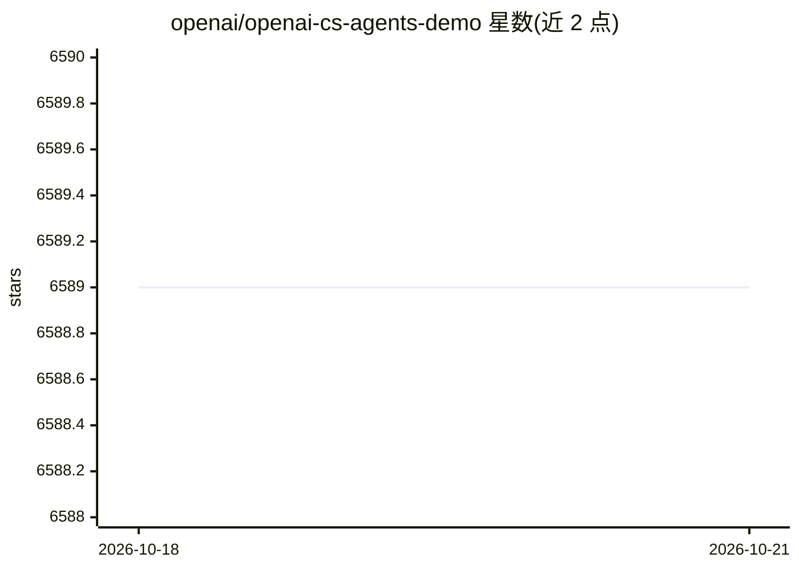

# openai/openai-cs-agents-demo

⭐ 6,589 · Python · MIT · 推送 2025-12-18 · [GitHub](https://github.com/openai/openai-cs-agents-demo) · 组织维护

**OpenAI Agents SDK 客服智能体示例：航班客服多 Agent 编排**

OpenAI 官方演示项目：基于 Agents SDK 实现航空公司客服场景，由 Python 后端（uvicorn 运行的 agent 编排逻辑）与 Next.js 前端（ChatKit 聊天界面）组成。包含 6 个专职 Agent（分诊、航班信息、预订取消、座位特殊服务、FAQ、退款补偿），由 Triage Agent 路由；内置相关性与越狱两类护栏，使用模拟航班数据演示改签、补偿等流程。需设置 OPENAI_API_KEY，按 README 提供命令安装依赖并运行。

## 筛选速览

| 维度 | 判定 | 备注 |
|---|---|---|
| AI 角色 | `ai-ecosystem` | LLM/agent 周边工具 |
| 许可风险 | `permissive` | MIT |
| 部署形态 | `library` | 以包/库形式分发 |
| 模型依赖 | — | README 未给出锁定关系 |
| 硬件要求 | — | 无带数字的原话,不猜 |
| 安装摩擦 | `low` | 无编译、无系统依赖或容器化 |
| 成熟度 | — | 结构信号不足 |

## 能力要点

- 6 个专职 Agent 由 Triage Agent 分诊路由
- Relevance 与 Jailbreak 护栏约束对话范围
- 模拟航变场景演示自动改签与补偿发放
- Python 后端 + Next.js/ChatKit 前端可视化编排过程

## 适用场景

- 学习 Agents SDK 的多 Agent 编排与交接实现
- 作为客服智能体应用的起点进行改造扩展
- 演示护栏拦截无关请求与越狱尝试的效果

## 场景标签

`多智能体` · 领域:Agent 开发

## 证据(README 行号)

> L7: This repository contains a demo of a Customer Service interface built on top of the OpenAI Agents SDK.
> L11: 1. A python backend that handles the agent orchestration logic, implementing the Agents SDK customer service exampl

## 星数曲线

2026-10-18 6,589 → 2026-10-21 6,589（+0）

---
*卡片 v1 · prompt 1.4 · 生成 2026-10-20 · 置信度 high · 依据 README sha `d9afeb05194e` · [字段定义](../../DATASET.md)*
