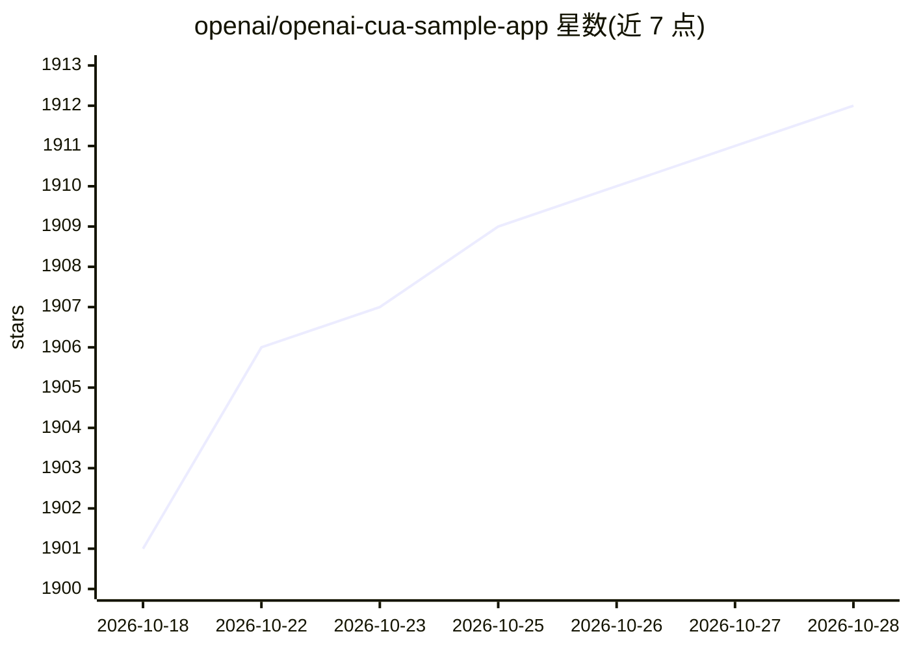

# openai/openai-cua-sample-app

⭐ 1,912 · TypeScript · MIT · 推送 2026-10-19 · [GitHub](https://github.com/openai/openai-cua-sample-app) · 组织维护

**OpenAI 计算机使用代理（CUA）示例应用集，含浏览器与桌面两种**

OpenAI 官方仓库，演示如何通过 Responses API 构建计算机使用代理：一个 agent 用 JavaScript+Playwright 控制浏览器，另一个用 Python+PyAutoGUI 通过截图与鼠标键盘控制桌面；均带共享 Web 控制台、实验场景（labs）与运行回放。另提供 OpenAI SDK 的 ComputerToolset 示例（Node.js/Python），在本地假预订实验页中运行 headless Chromium。要求 Node.js 22.20.0、pnpm 与 OpenAI API key，运行会消耗 API 额度；示例代码以用户权限执行，不含系统沙箱。

## 筛选速览

| 维度 | 判定 | 备注 |
|---|---|---|
| AI 角色 | `ai-ecosystem` | LLM/agent 周边工具 |
| 许可风险 | `permissive` | MIT |
| 部署形态 | `library` | 以包/库形式分发 |
| 模型依赖 | — | README 未给出锁定关系 |
| 硬件要求 | — | 无带数字的原话,不猜 |
| 安装摩擦 | `low` | 无编译、无系统依赖或容器化 |
| 成熟度 | — | 结构信号不足 |

## 能力要点

- 两条 agent 路径：Playwright 控制浏览器 / PyAutoGUI 控制桌面
- OpenAI SDK ComputerToolset 示例（Node.js 与 Python）
- 共享 Web 控制台、实验场景模板与运行回放（截图时间线）
- 持续运行时保持状态与辅助函数以减少模型往返

## 适用场景

- 学习如何基于 Responses API 构建 computer-use agent
- 参考 Playwright/PyAutoGUI 两种环境控制方式的实现
- 复用 SDK ComputerToolset 的预订场景示例做开发验证

## 场景标签

`浏览器自动化` `GUI 自动化` · 领域:效率与自动化

## 证据(README 行号)

> L3: Computer-use agents are AI systems that operate software to complete a task. They inspect an interface, choose an ac
> L7: This repository contains two computer-use agents: one runs JavaScript with **Playwright** to control a browser; the 
> L28: Use the OpenAI SDK computer-use helper with the same booking lab in Node.js or Python. Clone the repository, export

## 星数曲线

2026-10-18 1,901 → 2026-10-28 1,912（+11）

---
*卡片 v1 · prompt 1.4 · 生成 2026-10-21 · 置信度 mid · 依据 README sha `78d2a4f23c88` · [字段定义](../../DATASET.md)*
