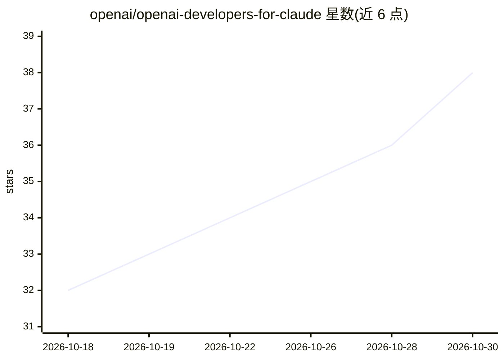

# openai/openai-developers-for-claude

⭐ 38 · JavaScript · Apache-2.0 · 推送 2026-07-13 · [GitHub](https://github.com/openai/openai-developers-for-claude) · 组织维护

**面向 Claude Code 的 OpenAI 开发者工作流插件包**

OpenAI 官方发布的 Claude Code 插件：捆绑公开的 OpenAI Docs MCP 服务器，并附带多个 Claude 原生技能，覆盖 OpenAI 文档问答、OPENAI_API_KEY 本地配置指引、API 故障排查分类、Agents SDK 应用规划与 ChatGPT Apps 构建等场景。用户可在 Claude 应用或 Claude Code 中通过插件市场安装。仅支持 Claude Code/Claude 应用环境，本地校验需运行 npm test。

## 筛选速览

| 维度 | 判定 | 备注 |
|---|---|---|
| AI 角色 | `ai-ecosystem` | LLM/agent 周边工具 |
| 许可风险 | `permissive` | Apache-2.0 |
| 部署形态 | `None` |  |
| 模型依赖 | — | README 未给出锁定关系 |
| 硬件要求 | — | 无带数字的原话,不猜 |
| 安装摩擦 | `low` | 无编译、无系统依赖或容器化 |
| 成熟度 | — | 结构信号不足 |

## 能力要点

- 捆绑公开 OpenAI Docs MCP 服务器
- 技能覆盖 OpenAI 文档问答、API key 配置、故障排查
- 支持 Agents SDK 规划与 ChatGPT Apps 构建/提交指引
- 可通过 Claude 插件市场或 Claude Code 命令安装

## 适用场景

- 在 Claude Code 中查阅 OpenAI 文档并构建 AI 应用
- 为 OpenAI API 开发配置本地密钥与排查运行时故障
- 在 Claude 内规划 Agents SDK 与 ChatGPT Apps 项目

## 场景标签

`文档问答` · 领域:知识与检索

## 证据(README 行号)

> L1: # OpenAI Developers Plugin for Claude Code
> L3: This plugin is the Claude Code-facing bundle for OpenAI developer workflows. It pairs the public OpenAI Docs MCP ser
> L9: - `plugins/openai-developers/.mcp.json` bundles the public OpenAI Docs MCP server.
> L10: - `plugins/openai-developers/skills/openai-docs/` routes OpenAI product, API, model, SDK, prompting, and model-upgr

## 星数曲线

2026-10-18 32 → 2026-10-30 38（+6）

---
*卡片 v1 · prompt 1.4 · 生成 2026-10-25 · 置信度 high · 依据 README sha `94eb89e7a702` · [字段定义](../../DATASET.md)*
