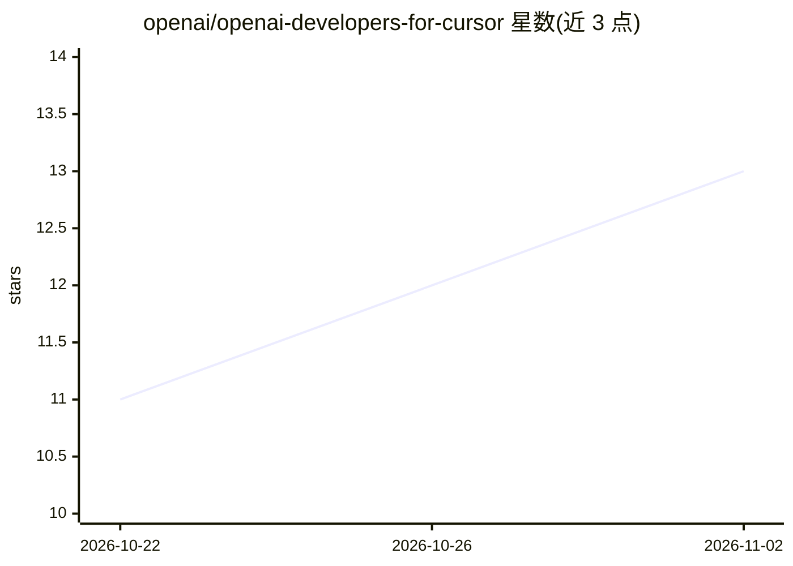

# openai/openai-developers-for-cursor

⭐ 13 · JavaScript · Apache-2.0 · 推送 2026-07-13 · [GitHub](https://github.com/openai/openai-developers-for-cursor) · 组织维护

**面向 Cursor 的 OpenAI 开发者工作流插件包（MCP+技能）**

OpenAI 官方发布的 Cursor 插件：捆绑公开的 OpenAI Docs MCP server 配置与多项 Cursor 原生技能，覆盖 OpenAI 产品/API/模型/SDK 文档问答、本地 OPENAI_API_KEY 配置指引、运行时 API 故障分类，以及 Agents SDK 与 ChatGPT Apps SDK 项目的规划构建。面向在 Cursor 中开发 AI 应用、agent 与 ChatGPT Apps 的开发者；Teams/Enterprise 通过团队市场导入仓库安装。限制：插件不能自动创建或获取 API key。

## 筛选速览

| 维度 | 判定 | 备注 |
|---|---|---|
| AI 角色 | `ai-ecosystem` | LLM/agent 周边工具 |
| 许可风险 | `permissive` | Apache-2.0 |
| 部署形态 | `None` |  |
| 模型依赖 | — | README 未给出锁定关系 |
| 硬件要求 | — | 无带数字的原话,不猜 |
| 安装摩擦 | `low` | 无编译、无系统依赖或容器化 |
| 成熟度 | — | 结构信号不足 |

## 能力要点

- 捆绑 OpenAI Docs MCP server 配置（mcp.json）
- 6 项 Cursor 技能：文档问答/API key 配置/故障排查/Agents SDK/ChatGPT Apps 构建与提交
- 文档问答经由 MCP server 使用实时 OpenAI 文档，含当前模型元数据

## 适用场景

- 在 Cursor 中直接查询 OpenAI 最新模型与 API 用法
- 引导配置本地 OPENAI_API_KEY 并排查 API 运行时故障
- 在 Cursor 内规划构建 Agents SDK 与 ChatGPT Apps 项目

## 场景标签

`文档问答` · 领域:知识与检索

## 证据(README 行号)

> L3: This plugin is the Cursor-facing bundle for OpenAI developer workflows. It pairs the public OpenAI Docs MCP server w
> L9: - `skills/openai-docs/` routes OpenAI product, API, model, and SDK questions through live OpenAI documentation, incl

## 星数曲线

2026-10-22 11 → 2026-11-02 13（+2）

---
*卡片 v1 · prompt 1.4 · 生成 2026-11-01 · 置信度 high · 依据 README sha `39da6997f9c5` · [字段定义](../../DATASET.md)*
