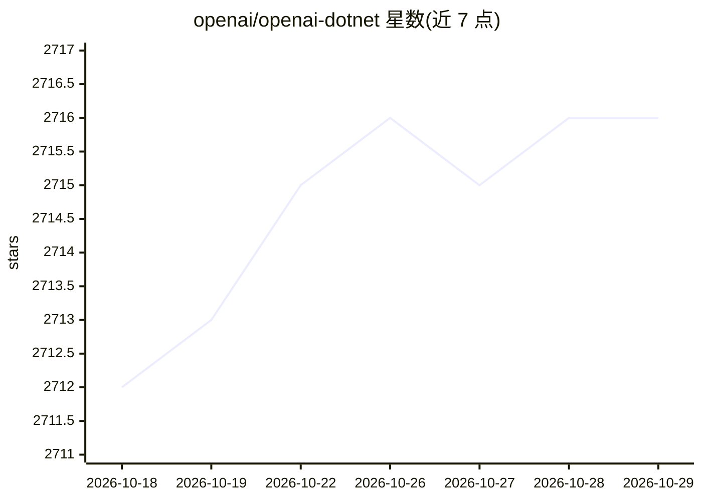

# openai/openai-dotnet

⭐ 2,716 · C# · MIT · 推送 2026-10-28 · [GitHub](https://github.com/openai/openai-dotnet) · [官网](https://www.nuget.org/packages/OpenAI) · 组织维护

**OpenAI 官方 .NET SDK：.NET 应用调用 OpenAI REST API**

由 OpenAI 官方维护并与 Microsoft 合作开发的 .NET 客户端库，基于 OpenAPI 规范生成，为 .NET 应用提供对 OpenAI REST API 的访问。按功能命名空间组织 14 个客户端类（Chat/Audio/Embeddings/FineTuning/Realtime/VectorStores 等），支持流式补全、工具函数调用、结构化输出、音频输入输出、异步与同步变体，可注册为 ASP.NET Core 依赖注入单例，并支持自定义 base URL 连接 OpenAI 兼容端点。需 OpenAI API key，通过 NuGet 安装，兼容 .NET Standard 2.0。

## 筛选速览

| 维度 | 判定 | 备注 |
|---|---|---|
| AI 角色 | `ai-ecosystem` | LLM/agent 周边工具 |
| 许可风险 | `permissive` | MIT |
| 部署形态 | `None` |  |
| 模型依赖 | locked-api |  |
| 硬件要求 | — | 无带数字的原话,不猜 |
| 安装摩擦 | `medium` | 含编译或系统依赖之一 |
| 成熟度 | — | 结构信号不足 |

## 能力要点

- 14 个功能命名空间客户端覆盖 Chat/Realtime/Embeddings/FineTuning 等功能
- 支持流式补全、工具函数调用与结构化输出
- 支持自定义 base URL 连接 OpenAI 兼容 API 或自托管端点
- 客户端线程安全，可注册为 ASP.NET Core DI 单例

## 适用场景

- 在 .NET 应用中调用 OpenAI 对话补全与嵌入接口
- 构建带工具调用与结构化输出的 agent 应用
- 通过代理或自托管 OpenAI 兼容服务接入

## 场景标签

 · 领域:LLM 基础设施/API SDK

## 证据(README 行号)

> L5: The OpenAI .NET library provides convenient access to the OpenAI REST API from .NET applications.
> L46: If you need to connect to an alternative API endpoint (for example, a proxy or self-hosted OpenAI-compatible LLM), 

## 星数曲线

2026-10-18 2,712 → 2026-10-29 2,716（+4）

---
*卡片 v1 · prompt 1.4 · 生成 2026-10-21 · 置信度 high · 依据 README sha `5559a8fd4fdc` · [字段定义](../../DATASET.md)*
