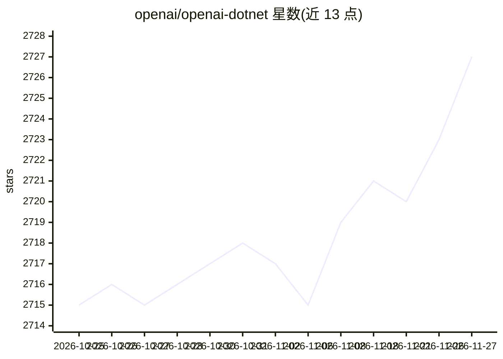

# openai/openai-dotnet

⭐ 2,727 · C# · MIT · 推送 2026-11-26 · [GitHub](https://github.com/openai/openai-dotnet) · [官网](https://www.nuget.org/packages/OpenAI) · 组织维护

**.NET 开发者访问 OpenAI REST API 的官方客户端库**

OpenAI 官方与 Microsoft 协作、由 OpenAPI 规范生成的 .NET 客户端库，从 .NET 应用中访问 OpenAI REST API。按功能域划分命名空间（Chat、Audio、Embeddings、Images、FineTuning、Realtime、VectorStores 等 16 个客户端类），每个同步方法提供对应异步变体，支持流式聊天补全、函数调用/工具、结构化输出、聊天音频输入输出。客户端线程安全，可注册为 ASP.NET Core 依赖注入单例；可通过自定义 base URL 接入代理或 OpenAI 兼容端点。安装经 NuGet 包，兼容 .NET Standard 2.0 应用。

## 筛选速览

| 维度 | 判定 | 备注 |
|---|---|---|
| AI 角色 | `ai-ecosystem` | LLM/agent 周边工具 |
| 许可风险 | `permissive` | MIT |
| 部署形态 | `None` |  |
| 模型依赖 | locked-api |  |
| 硬件要求 | — | 无带数字的原话,不猜 |
| 安装摩擦 | `medium` | 含编译或系统依赖之一 |
| 成熟度 | — | 结构信号不足 |

## 能力要点

- 由 OpenAPI 规范生成、与 Microsoft 协作的官方 .NET 客户端
- 16 个功能域客户端类，同步/异步方法成对提供
- 支持流式补全、函数调用、结构化输出与音频输入输出
- 兼容 .NET Standard 2.0，支持依赖注入与自定义 base URL

## 适用场景

- 在 C#/.NET 应用中调用聊天补全、嵌入、图像、语音等 OpenAI API
- 用 ASP.NET Core 依赖注入方式在服务端接入 OpenAI 客户端
- 接入代理或自托管的 OpenAI 兼容 LLM 端点
- 实现带工具/函数调用的对话应用

## 场景标签

 · 领域:LLM 基础设施/客户端 SDK

## 证据(README 行号)

> L5: The OpenAI .NET library provides convenient access to the OpenAI REST API from .NET applications.
> L7: It is generated from our OpenAPI specification in collaboration with Microsoft.
> L66: |`OpenAI.Chat`|`ChatClient`|

## 星数曲线

2026-10-25 2,715 → 2026-11-27 2,727（+12）

---
*卡片 v1 · prompt 1.4 · 生成 2026-11-23 · 置信度 high · 依据 README sha `102a85f16add` · [字段定义](../../DATASET.md)*
