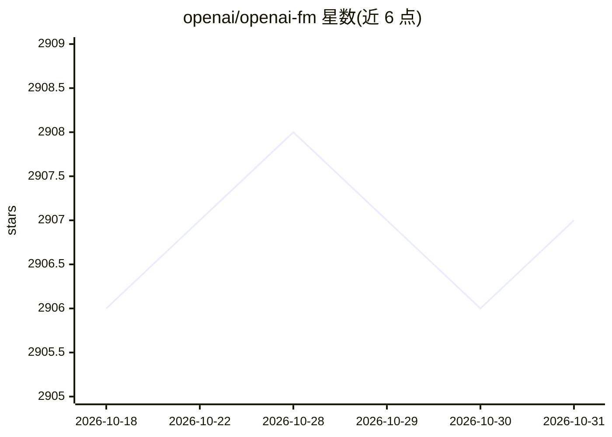

# openai/openai-fm

⭐ 2,907 · TypeScript · MIT · 推送 2026-03-03 · [GitHub](https://github.com/openai/openai-fm) · [官网](https://openai.fm) · 组织维护

**OpenAI 文本转语音模型的交互式演示网站（openai.fm 源码）**

openai.fm 的源码，用 NextJS 构建的交互式演示，展示 OpenAI 新的文本转语音模型，通过 Speech API 生成语音。运行需克隆仓库、设置 OPENAI_API_KEY 环境变量、npm install 后 npm run dev 启动，应用运行在 localhost:3000。分享功能为可选，需额外连接托管 Postgres 数据库，不配置也可运行应用。注意公开部署时 API key 产生的用量由部署者负责。

## 筛选速览

| 维度 | 判定 | 备注 |
|---|---|---|
| AI 角色 | `ai-native` | 本体是模型或模型工具 |
| 许可风险 | `permissive` | MIT |
| 部署形态 | `library` | 以包/库形式分发 |
| 模型依赖 | — | README 未给出锁定关系 |
| 硬件要求 | — | 无带数字的原话,不猜 |
| 安装摩擦 | `low` | 无编译、无系统依赖或容器化 |
| 成熟度 | — | 结构信号不足 |

## 能力要点

- 基于 NextJS 与 OpenAI Speech API 构建的文本转语音演示
- 本地运行步骤：clone、设置 OPENAI_API_KEY、npm install、npm run dev
- 可选连接托管 Postgres 数据库以启用分享功能
- MIT 许可证

## 适用场景

- 在本地运行并体验 OpenAI 文本转语音模型
- 学习 Speech API 与 NextJS 集成的示例代码
- 自行部署一个 TTS 演示界面

## 场景标签

`语音合成` · 领域:内容生成

## 证据(README 行号)

> L7: OpenAI.fm is an interactive demo to showcase the new OpenAI text-to-speech models.
> L8: It is built with NextJS and the Speech API.

## 星数曲线

2026-10-18 2,906 → 2026-10-31 2,907（+1）

---
*卡片 v1 · prompt 1.4 · 生成 2026-10-21 · 置信度 high · 依据 README sha `2a30287659e5` · [字段定义](../../DATASET.md)*
