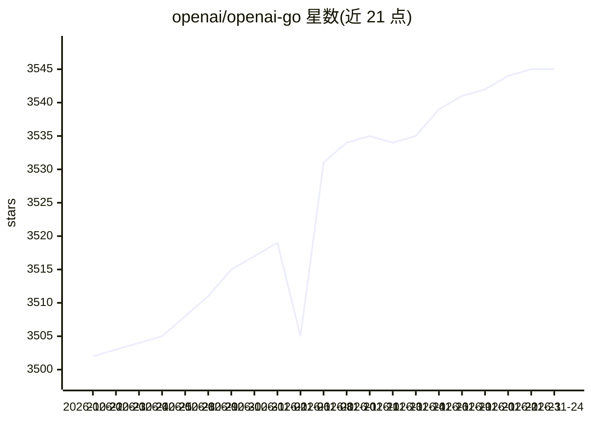

# openai/openai-go

⭐ 3,545 · Go · Apache-2.0 · 推送 2026-11-22 · [GitHub](https://github.com/openai/openai-go) · 组织维护

**OpenAI 官方 Go SDK：在 Go 应用中调用 OpenAI API**

OpenAI 官方维护的 Go 语言库，通过 import github.com/openai/openai-go/v3 引入，要求 Go 1.26 及以上版本，旧版 Go 需固定对应旧 SDK 版本。提供对 OpenAI REST API 的访问，README 演示 Responses API 文本生成、多轮对话、Conversations、流式响应、工具调用、结构化输出，以及 Responses 与 Realtime 的 WebSocket 连接：支持多 lane 路由、事件累积快照、断线恢复、服务端压缩（compaction）与服务限流处理。API 全量清单见 api.md。

## 筛选速览

| 维度 | 判定 | 备注 |
|---|---|---|
| AI 角色 | `ai-ecosystem` | LLM/agent 周边工具 |
| 许可风险 | `permissive` | Apache-2.0 |
| 部署形态 | `None` |  |
| 模型依赖 | — | README 未给出锁定关系 |
| 硬件要求 | — | 无带数字的原话,不猜 |
| 安装摩擦 | `low` | 无编译、无系统依赖或容器化 |
| 成熟度 | — | 结构信号不足 |

## 能力要点

- 官方 Go SDK，go get 安装，要求 Go 1.26+
- 支持 Responses API：文本生成、多轮对话、工具调用、结构化输出
- 支持流式响应与 Responses/Realtime WebSocket 连接
- WebSocket 模式提供 lane、事件累积快照、错误恢复与压缩机制

## 适用场景

- 在 Go 服务端应用中调用 OpenAI 模型生成文本
- 构建需要流式输出的对话应用
- 通过 WebSocket 维持长连接的多轮响应会话

## 场景标签

 · 领域:LLM 基础设施/SDK

## 证据(README 行号)

> L5: The OpenAI Go library provides convenient access to the OpenAI REST API
> L43: The full API of this library can be found in api.md.

## 星数曲线

2026-10-22 3,502 → 2026-11-24 3,545（+43）

---
*卡片 v1 · prompt 1.4 · 生成 2026-11-23 · 置信度 high · 依据 README sha `b6d5f37778a0` · [字段定义](../../DATASET.md)*
