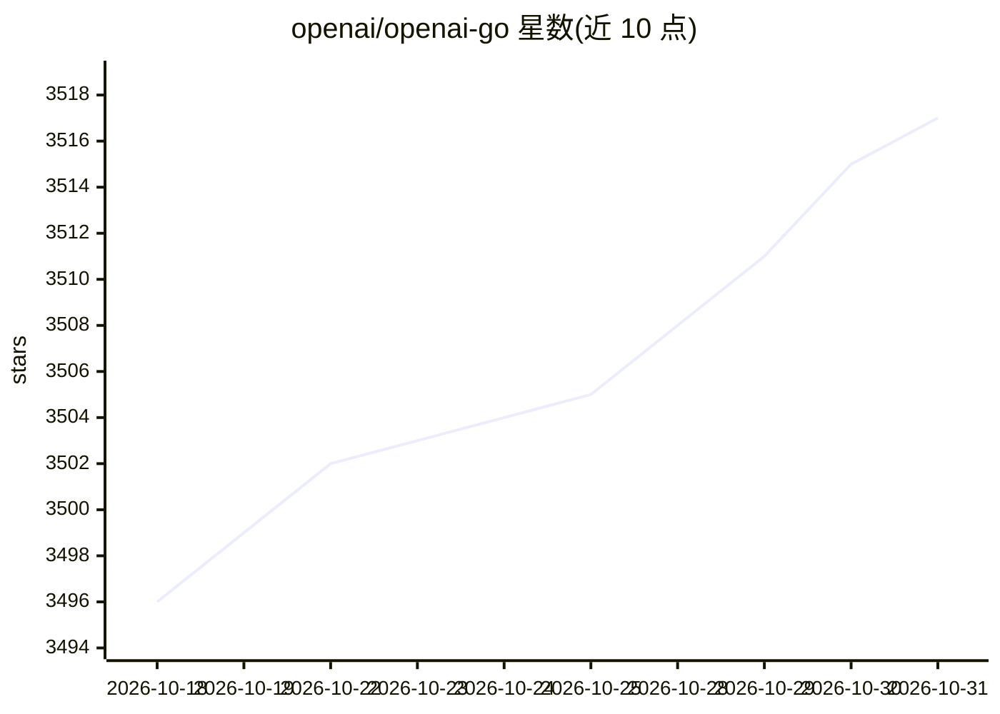

# openai/openai-go

⭐ 3,517 · Go · Apache-2.0 · 推送 2026-10-30 · [GitHub](https://github.com/openai/openai-go) · 组织维护

**OpenAI API 的官方 Go 客户端库，供 Go 应用调用模型**

OpenAI 官方维护的 Go 语言 SDK，封装对 OpenAI REST API 的访问：支持 Responses API（含流式、工具调用、结构化输出、WebSocket 长连接与多 lane 路由）、Conversations 及 Chat Completions API。请求字段采用 omitzero 序列化语义，WebSocket 模式提供缓冲上限、重连恢复与服务限制参数。要求 Go 1.26+（旧版 Go 需回退到历史 SDK 版本且无安全修复保证）。面向在 Go 应用中接入 OpenAI 服务的开发者。

## 筛选速览

| 维度 | 判定 | 备注 |
|---|---|---|
| AI 角色 | `ai-ecosystem` | LLM/agent 周边工具 |
| 许可风险 | `permissive` | Apache-2.0 |
| 部署形态 | `None` |  |
| 模型依赖 | — | README 未给出锁定关系 |
| 硬件要求 | — | 无带数字的原话,不猜 |
| 安装摩擦 | `low` | 无编译、无系统依赖或容器化 |
| 成熟度 | — | 结构信号不足 |

## 能力要点

- 覆盖 Responses/Conversations/Chat Completions API
- WebSocket 长连接支持多 lane 并发、fork 与显式重连恢复
- 流式响应、工具调用与结构化输出示例
- 可通过 base URL 等配置接入 Azure OpenAI 与 AWS Bedrock 兼容端点

## 适用场景

- 在 Go 服务中调用 OpenAI 模型生成文本
- 构建流式对话或工具调用（function calling）流程
- 用 WebSocket 维持可复用的多轮模型会话连接

## 场景标签

 · 领域:LLM 基础设施/API 客户端

## 证据(README 行号)

> L5: The OpenAI Go library provides convenient access to the OpenAI REST API
> L45: The primary API for interacting with OpenAI models is the Responses API. You can generate text from the model with 

## 星数曲线

2026-10-18 3,496 → 2026-10-31 3,517（+21）

---
*卡片 v1 · prompt 1.4 · 生成 2026-10-20 · 置信度 high · 依据 README sha `41a213f4f89e` · [字段定义](../../DATASET.md)*
