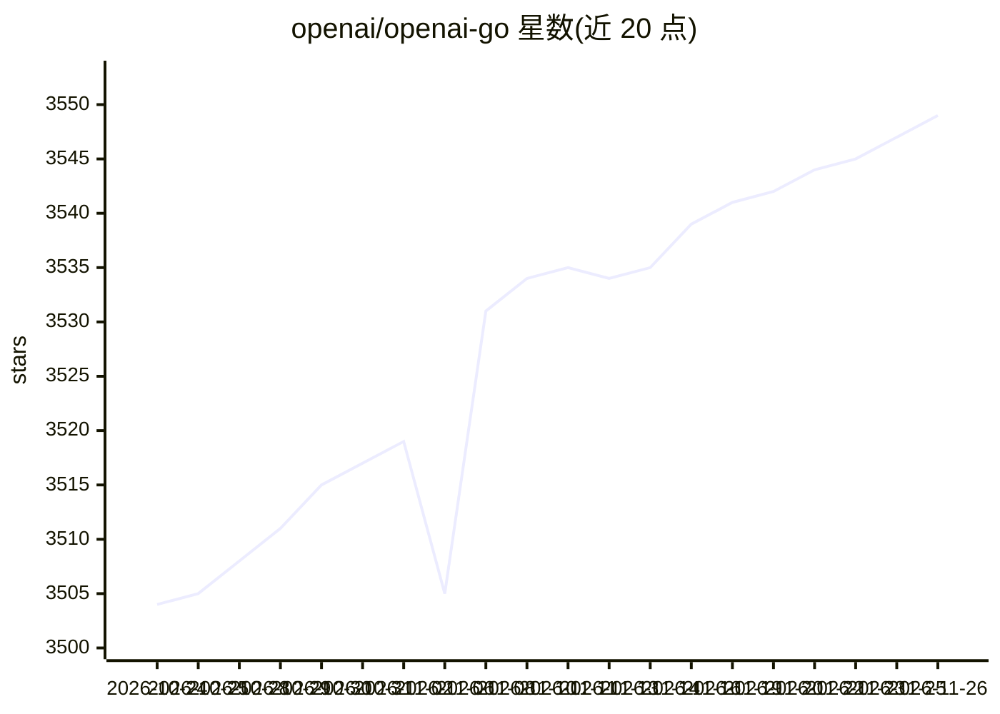

# openai/openai-go

⭐ 3,549 · Go · Apache-2.0 · 推送 2026-11-25 · [GitHub](https://github.com/openai/openai-go) · 组织维护

**Go 应用的 OpenAI API 官方客户端库**

OpenAI 官方提供的 Go 语言 SDK，封装 OpenAI REST API 的访问：支持 Responses API 的文本生成、多轮对话、流式响应、工具调用与结构化输出，并提供 Responses WebSocket 连接（lane/turn/恢复机制、上下文压缩）与 Realtime WebSocket 会话。要求 Go 1.26 及以上，旧 Go 版本需固定旧 SDK 版本。面向使用 Go 编写并需接入 OpenAI API 的开发者。

## 筛选速览

| 维度 | 判定 | 备注 |
|---|---|---|
| AI 角色 | `ai-ecosystem` | LLM/agent 周边工具 |
| 许可风险 | `permissive` | Apache-2.0 |
| 部署形态 | `None` |  |
| 模型依赖 | — | README 未给出锁定关系 |
| 硬件要求 | — | 无带数字的原话,不猜 |
| 安装摩擦 | `low` | 无编译、无系统依赖或容器化 |
| 成熟度 | — | 结构信号不足 |

## 能力要点

- Responses API：文本生成、多轮对话、流式响应、工具调用、结构化输出
- Responses WebSocket 连接，支持 lane、断线恢复与增量快照（ResponseAccumulator）
- Realtime WebSocket 会话接入
- 上下文压缩（compaction）与服务端限制参数的封装

## 适用场景

- 在 Go 后端服务中调用 OpenAI 模型生成文本
- 构建需要流式输出与工具调用的对话应用
- 通过 WebSocket 维持长连接的多轮响应会话

## 场景标签

 · 领域:LLM 基础设施/客户端 SDK

## 证据(README 行号)

> L5: The OpenAI Go library provides convenient access to the OpenAI REST API
> L6: from applications written in Go.
> L45: The primary API for interacting with OpenAI models is the Responses API. You can generate text from the model with 

## 星数曲线

2026-10-24 3,504 → 2026-11-26 3,549（+45）

---
*卡片 v1 · prompt 1.4 · 生成 2026-11-25 · 置信度 high · 依据 README sha `86f6e0bd92ac` · [字段定义](../../DATASET.md)*
