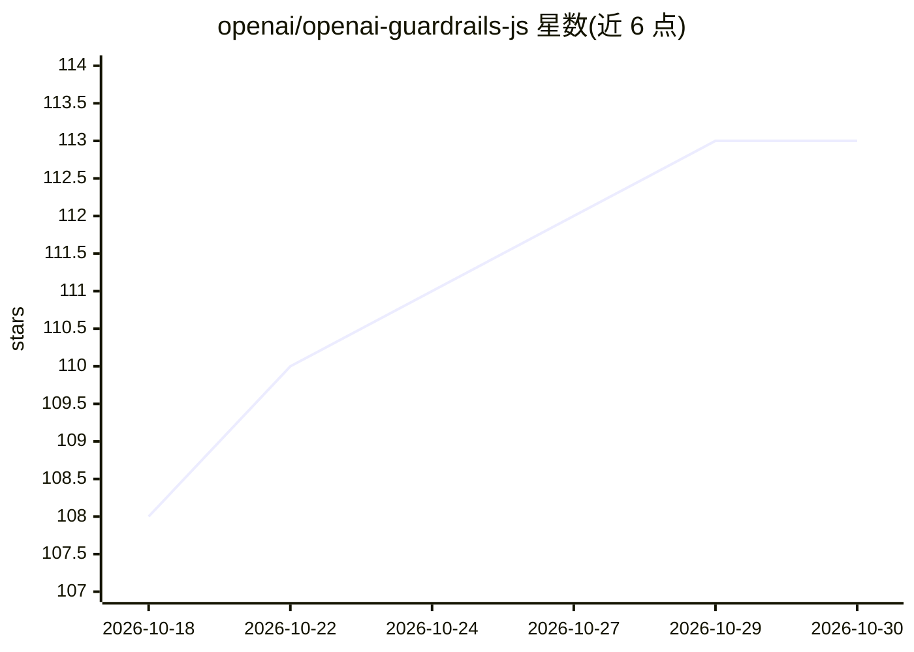

# openai/openai-guardrails-js

⭐ 113 · TypeScript · MIT · 推送 2026-10-26 · [GitHub](https://github.com/openai/openai-guardrails-js) · [官网](https://guardrails.openai.com) · 组织维护

**给 OpenAI 应用加输入输出安全检查的 TypeScript 库**

封装 OpenAI JavaScript/TypeScript 客户端的 Guardrails 库，在 responses.create() 与 chat.completions.create() 调用上添加可配置的 preflight/输入/输出检查；内置 Moderation、PII、URL 过滤、幻觉检测、越狱、提示注入等检查项，支持 Azure OpenAI、本地模型、流式处理与 Agents SDK 集成。提供配置向导与 CLI 评测工具，可对标注数据集计算 precision/recall/F1。需 Node.js 22.13+ 或 24+，调用付费 OpenAI API，费用由开发者承担。

## 筛选速览

| 维度 | 判定 | 备注 |
|---|---|---|
| AI 角色 | `ai-ecosystem` | LLM/agent 周边工具 |
| 许可风险 | `permissive` | MIT |
| 部署形态 | `library` | 以包/库形式分发 |
| 模型依赖 | locked-api |  |
| 硬件要求 | — | 无带数字的原话,不猜 |
| 安装摩擦 | `low` | 无编译、无系统依赖或容器化 |
| 成熟度 | `idea` | |

## 能力要点

- 内置 Moderation/PII/幻觉检测/提示注入等 8 类检查
- 支持 Azure OpenAI、本地模型与 Agents SDK 集成
- CLI 可对标注数据集评测 guardrail 的 precision/recall/F1
- 支持流式处理与不触发 tripwire 的检查模式

## 适用场景

- 在 LLM 应用上线前拦截违规输入与不安全输出
- 检测用户输入中的提示注入与越狱尝试
- 用自有标注数据集评测护栏配置的效果

## 场景标签

 · 领域:LLM 安全/开发工具

## 证据(README 行号)

> L3: Add configurable input and output checks to your OpenAI applications. Guardrails wraps the OpenAI JavaScript/TypeScr
> L40: Built-in checks include Moderation, Contains PII, URL Filter, Hallucination Detection, Jailbreak, Prompt Injection 

## 星数曲线

2026-10-18 108 → 2026-10-30 113（+5）

---
*卡片 v1 · prompt 1.4 · 生成 2026-10-23 · 置信度 high · 依据 README sha `ed5a9651e044` · [字段定义](../../DATASET.md)*
