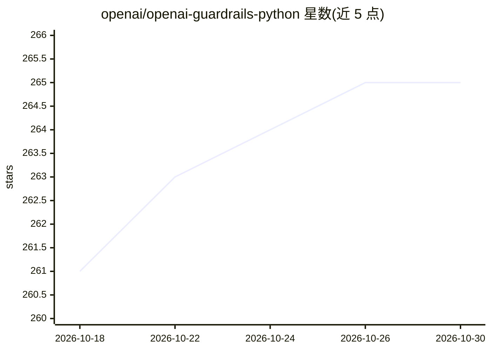

# openai/openai-guardrails-python

⭐ 265 · Python · MIT · 推送 2026-10-26 · [GitHub](https://github.com/openai/openai-guardrails-python) · [官网](https://guardrails.openai.com) · 组织维护

**给 LLM 应用加可配置安全与合规检查的 Python 护栏库**

OpenAI 官方 Python 库（Preview 阶段），封装 OpenAI Python 客户端，在请求前后执行可配置的护栏检查：关键词过滤、竞品提及、Moderation API、URL 过滤、密钥检测、PII（基于 spaCy 模型）、幻觉检测（对照向量库）、越狱与提示注入检测、NSFW、离题与自定义提示检查等 13 类。护栏配置通过向导导出 JSON 文件使用，触发时可抛出 tripwire 异常；同时集成 OpenAI Agents SDK（GuardrailAgent），并提供在标注数据集上评测护栏表现的评测工具。Requires Python 3.11+，pip 安装。

## 筛选速览

| 维度 | 判定 | 备注 |
|---|---|---|
| AI 角色 | `ai-ecosystem` | LLM/agent 周边工具 |
| 许可风险 | `permissive` | MIT |
| 部署形态 | `library` | 以包/库形式分发 |
| 模型依赖 | — | README 未给出锁定关系 |
| 硬件要求 | — | 无带数字的原话,不猜 |
| 安装摩擦 | `low` | 无编译、无系统依赖或容器化 |
| 成熟度 | `idea` | |

## 能力要点

- 13 类可配置护栏：PII、密钥、幻觉、越狱、提示注入、Moderation 等
- 封装 OpenAI 客户端与 Agents SDK（GuardrailAgent / GuardrailsOpenAI）
- 提供标注数据集上的护栏评测与基准工具（benchmark 扩展）
- 配置经向导导出 JSON，触发护栏抛出 GuardrailTripwireTriggered

## 适用场景

- 为我的 LLM 应用在输入输出两侧拦截 PII 与密钥泄露
- 在 Agents SDK 的 agent 上加越狱与提示注入防护
- 用标注数据集测量护栏配置的触发准确率

## 场景标签

`网络安全` · 领域:学习与行业

## 证据(README 行号)

> L3: Add configurable safety and compliance checks to LLM applications. OpenAI Guardrails wraps the OpenAI Python client 
> L48: Use `GuardrailAgent` with the OpenAI Agents SDK. This example uses the same config file and API key as the quicksta

## 星数曲线

2026-10-18 261 → 2026-10-30 265（+4）

---
*卡片 v1 · prompt 1.4 · 生成 2026-10-22 · 置信度 high · 依据 README sha `e5cc7cf9b56f` · [字段定义](../../DATASET.md)*
