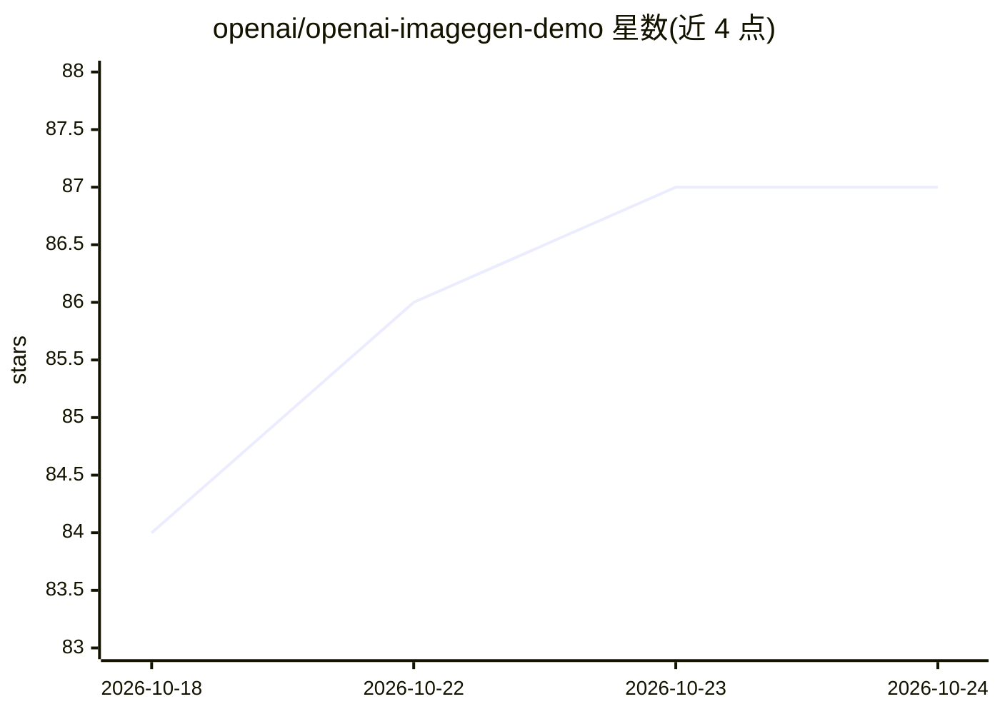

# openai/openai-imagegen-demo

⭐ 87 · TypeScript · MIT · 推送 2026-09-16 · [GitHub](https://github.com/openai/openai-imagegen-demo) · 组织维护

**OpenAI 官方 Next.js 照片亭 Demo：用 Image API 生成人像风格**

基于 Next.js（App Router）+ TypeScript + Tailwind CSS 构建的照片亭示例应用：拍摄或上传人像后，通过 OpenAI Image API（/images/edits）生成多种风格图像，支持 Sunburst、Flare（默认）与 GPT Image 2 模型选择，最多同时选 4 种风格，支持流式部分生成、失败风格单独重试、结果预览与下载。需配置 OPENAI_API_KEY，通过 npm 安装依赖并运行开发服务器，代码组织与风格提示词均可自定义。

## 筛选速览

| 维度 | 判定 | 备注 |
|---|---|---|
| AI 角色 | `ai-native` | 本体是模型或模型工具 |
| 许可风险 | `permissive` | MIT |
| 部署形态 | `library` | 以包/库形式分发 |
| 模型依赖 | — | README 未给出锁定关系 |
| 硬件要求 | — | 无带数字的原话,不猜 |
| 安装摩擦 | `low` | 无编译、无系统依赖或容器化 |
| 成熟度 | — | 结构信号不足 |

## 能力要点

- 拍摄或上传人像并经 /images/edits 生成多风格图像
- Sunburst / Flare / GPT Image 2 模型选择器
- 流式部分生成与失败风格重试
- 风格提示词与模型选项可在源码文件中自定义

## 适用场景

- 学习 OpenAI Image API 编辑模式的接入方式
- 体验多风格人像生成的完整 Web 流程
- 作为 Next.js 流式图像生成应用的参考实现

## 场景标签

`图像生成` · 领域:内容生成

## 证据(README 行号)

> L8: This repo contains a simple photobooth demo built with Next.js that lets you capture or upload a portrait and create
> L19: - Integration with the OpenAI Image API

## 星数曲线

2026-10-18 84 → 2026-10-24 87（+3）

---
*卡片 v1 · prompt 1.4 · 生成 2026-10-23 · 置信度 high · 依据 README sha `bcadf4851bdb` · [字段定义](../../DATASET.md)*
