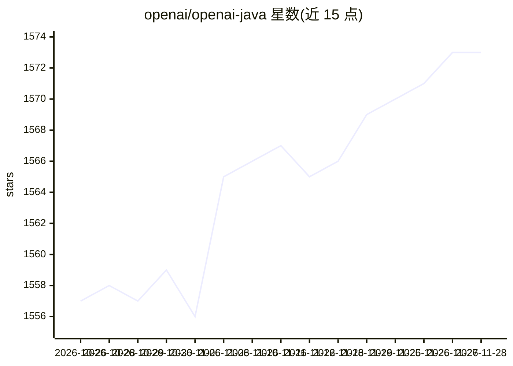

# openai/openai-java

⭐ 1,573 · Kotlin · Apache-2.0 · 推送 2026-11-26 · [GitHub](https://github.com/openai/openai-java) · 组织维护

**Java 开发者接入 OpenAI REST API 的官方 SDK**

OpenAI 官方 Java SDK，从 Java 应用访问 OpenAI REST API。主推 Responses API，Chat Completions API 持续支持；提供同步/异步客户端、SSE 流式响应与流累积辅助类、JSON Schema 结构化输出。客户端支持系统属性/环境变量配置及自定义 baseUrl；提供 Kubernetes、Azure、GCP 的 workload identity 短期令牌认证与 X.509 证书交换。可选 openai-java-bedrock 工件支持以 AWS 凭证调用 Amazon Bedrock 上的 OpenAI 兼容 API。SDK 工件要求 Java 8 或更高。

## 筛选速览

| 维度 | 判定 | 备注 |
|---|---|---|
| AI 角色 | `ai-ecosystem` | LLM/agent 周边工具 |
| 许可风险 | `permissive` | Apache-2.0 |
| 部署形态 | `None` |  |
| 模型依赖 | — | README 未给出锁定关系 |
| 硬件要求 | — | 无带数字的原话,不猜 |
| 安装摩擦 | `medium` | 含编译或系统依赖之一 |
| 成熟度 | — | 结构信号不足 |

## 能力要点

- 提供 Responses API 与 Chat Completions API 的 Java 客户端访问
- 同步与异步客户端，支持 SSE/JSONL 流式响应与流累积辅助类
- 支持 Kubernetes/Azure/GCP workload identity 与 X.509 证书短期令牌认证
- 可选 openai-java-bedrock 工件接入 Amazon Bedrock 上的 OpenAI 兼容 API

## 适用场景

- 在 Java 应用中调用 OpenAI 模型生成文本
- 处理流式响应并累积为完整 ChatCompletion/Response 对象
- 在云环境（Kubernetes/Azure/GCP）中以短期令牌认证替代长期 API key
- 通过 AWS 凭证调用 Bedrock 上的 OpenAI 兼容 API

## 场景标签

 · 领域:LLM 基础设施/API 客户端

## 证据(README 行号)

> L6: The OpenAI Java SDK provides convenient access to the OpenAI REST API from applications written in Java.
> L50: The primary API for interacting with OpenAI models is the Responses API. You can generate text from the model with 
> L30: The framework-neutral SDK artifacts require Java 8 or later. Runtime floors and lifecycle states

## 星数曲线

2026-10-26 1,557 → 2026-11-28 1,573（+16）

---
*卡片 v1 · prompt 1.4 · 生成 2026-11-27 · 置信度 high · 依据 README sha `f230c5c0defc` · [字段定义](../../DATASET.md)*
