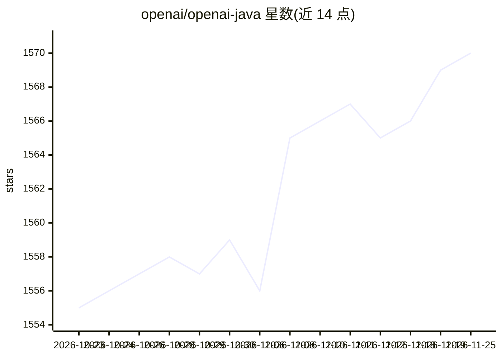

# openai/openai-java

⭐ 1,570 · Kotlin · Apache-2.0 · 推送 2026-11-23 · [GitHub](https://github.com/openai/openai-java) · 组织维护

**官方 Java 库：在 Java 应用中调用 OpenAI REST API**

OpenAI 官方发布的 Java SDK，从 Java 应用访问 OpenAI REST API，通过 Maven Central 分发，要求 Java 8 及以上。主 API 为 Responses API，同时长期支持 Chat Completions API；提供同步与异步客户端、SSE/JSONL 流式响应、流式累积辅助类、结构化输出 JSON schema、不可变类与 builder、客户端配置（系统属性/环境变量）。另提供可选 openai-java-bedrock artifact 调用 Amazon Bedrock 上的 OpenAI 兼容 API；支持 Kubernetes/Azure/GCP 工作负载身份认证与 X.509 证书交换短期令牌。

## 筛选速览

| 维度 | 判定 | 备注 |
|---|---|---|
| AI 角色 | `ai-ecosystem` | LLM/agent 周边工具 |
| 许可风险 | `permissive` | Apache-2.0 |
| 部署形态 | `None` |  |
| 模型依赖 | locked-api |  |
| 硬件要求 | — | 无带数字的原话,不猜 |
| 安装摩擦 | `medium` | 含编译或系统依赖之一 |
| 成熟度 | — | 结构信号不足 |

## 能力要点

- 同步/异步客户端，支持 SSE 流式响应与 ChatCompletionAccumulator 累积
- 可选 openai-java-bedrock artifact 用 AWS 凭证调用 Bedrock 上的 OpenAI 兼容 API
- Kubernetes/Azure Managed Identity/GCP ID token 工作负载身份认证与 X.509 客户端证书
- 结构化输出 JSON schema 与 Responses 历史归一化辅助

## 适用场景

- 在 Java 后端服务中集成 OpenAI 文本生成与 Chat Completions
- 在 AWS Bedrock 上以 AWS 凭证调用 OpenAI 兼容模型
- 在 Kubernetes/Azure/GCP 云环境中用短期令牌认证替代长期 API key
- Java 应用中处理流式输出并累积为完整响应对象

## 场景标签

 · 领域:LLM 基础设施/API 客户端

## 证据(README 行号)

> L6: The OpenAI Java SDK provides convenient access to the OpenAI REST API from applications written in Java.
> L50: The primary API for interacting with OpenAI models is the Responses API. You can generate text from the model with 
> L70: Use the optional `openai-java-bedrock` artifact to call OpenAI-compatible APIs on Amazon Bedrock

## 星数曲线

2026-10-23 1,555 → 2026-11-25 1,570（+15）

---
*卡片 v1 · prompt 1.4 · 生成 2026-11-24 · 置信度 high · 依据 README sha `0a83626902d1` · [字段定义](../../DATASET.md)*
