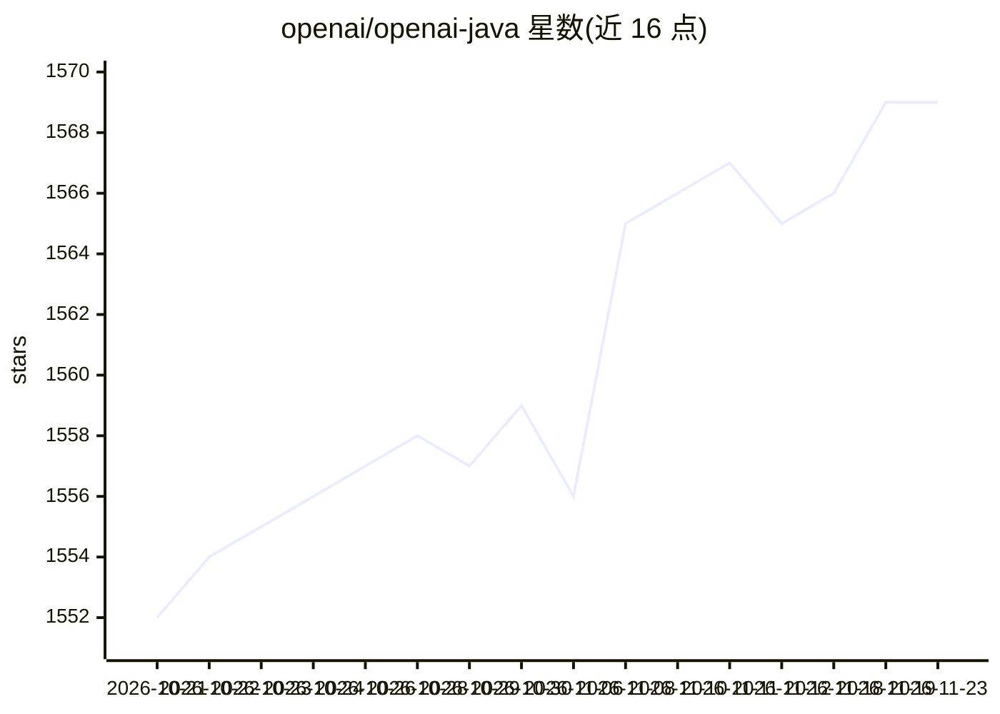

# openai/openai-java

⭐ 1,569 · Kotlin · Apache-2.0 · 推送 2026-11-22 · [GitHub](https://github.com/openai/openai-java) · 组织维护

**Java 应用访问 OpenAI REST API 的官方 SDK**

由 OpenAI 维护的 Java SDK，供 Java 应用调用 OpenAI REST API。以 Gradle/Maven 依赖发布到 Maven Central，要求 Java 8 及以上。主要接口为 Responses API，同时支持 Chat Completions API；提供同步/异步客户端、SSE 流式响应与流式累积辅助类、JSON schema 结构化输出。支持系统属性/环境变量/手动三种客户端配置方式，并内置 Kubernetes、Azure、GCP 等云环境的工作负载身份认证与 X.509 客户端证书认证。另提供可选的 openai-java-bedrock 构件接入 Amazon Bedrock 上的 OpenAI 兼容 API。

## 筛选速览

| 维度 | 判定 | 备注 |
|---|---|---|
| AI 角色 | `ai-ecosystem` | LLM/agent 周边工具 |
| 许可风险 | `permissive` | Apache-2.0 |
| 部署形态 | `None` |  |
| 模型依赖 | locked-api |  |
| 硬件要求 | — | 无带数字的原话,不猜 |
| 安装摩擦 | `medium` | 含编译或系统依赖之一 |
| 成熟度 | — | 结构信号不足 |

## 能力要点

- 支持 Responses API 与 Chat Completions API 生成文本
- 同步与异步客户端、SSE 流式响应及流式累积辅助类
- 内置云环境工作负载身份认证（Kubernetes/Azure/GCP）与 X.509 证书认证
- 可选 openai-java-bedrock 构件，用 AWS 凭证调用 Bedrock 上的 OpenAI 兼容 API

## 适用场景

- 在 Java 后端服务中接入 OpenAI API 生成文本
- 需要流式输出或结构化 JSON 输出的 Java 应用
- 在 Kubernetes/Azure/GCP 云环境中用短期令牌替代长期 API key 认证
- 通过 AWS 凭证调用 Amazon Bedrock 上的 OpenAI 兼容模型

## 场景标签

 · 领域:LLM 基础设施/API SDK

## 证据(README 行号)

> L6: The OpenAI Java SDK provides convenient access to the OpenAI REST API from applications written in Java.
> L50: The primary API for interacting with OpenAI models is the Responses API. You can generate text from the model with 

## 星数曲线

2026-10-21 1,552 → 2026-11-23 1,569（+17）

---
*卡片 v1 · prompt 1.4 · 生成 2026-11-23 · 置信度 high · 依据 README sha `b817e4461f9a` · [字段定义](../../DATASET.md)*
