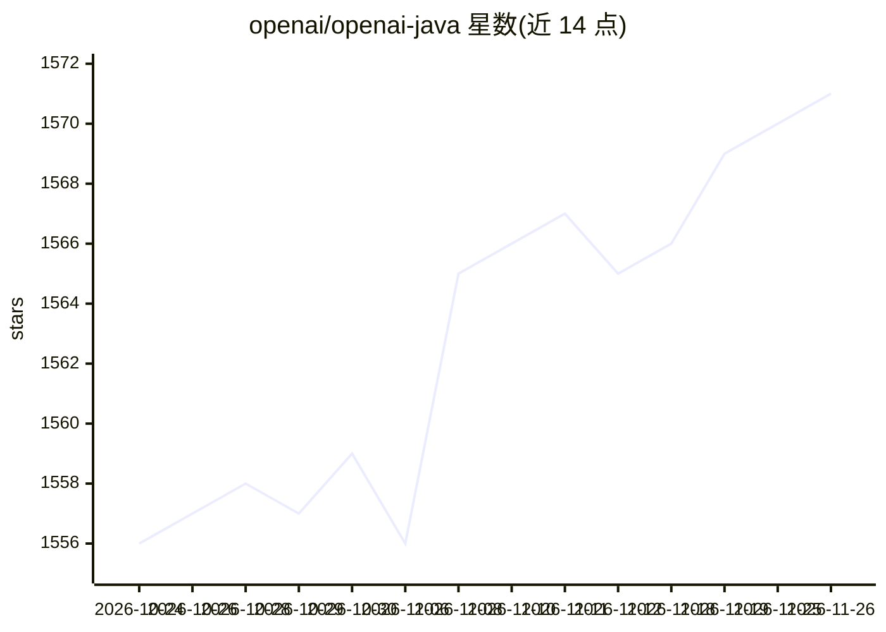

# openai/openai-java

⭐ 1,571 · Kotlin · Apache-2.0 · 推送 2026-11-25 · [GitHub](https://github.com/openai/openai-java) · 组织维护

**Java 应用访问 OpenAI REST API 的官方 SDK**

OpenAI 官方提供的 Java SDK，通过 Gradle 或 Maven 引入，要求 Java 8 及以上。核心机制：封装 Responses API 与 Chat Completions API 的请求构建与响应反序列化，支持系统属性/环境变量/手动三种客户端配置方式、同步与异步客户端、SSE/JSONL 流式响应及 ChatCompletionAccumulator 等流式累积辅助工具。另提供 openai-java-bedrock 可选构件以 AWS 凭证调用 Amazon Bedrock 上的 OpenAI 兼容 API，并内置 Kubernetes、Azure、GCP 云环境的工作负载身份认证。

## 筛选速览

| 维度 | 判定 | 备注 |
|---|---|---|
| AI 角色 | `ai-ecosystem` | LLM/agent 周边工具 |
| 许可风险 | `permissive` | Apache-2.0 |
| 部署形态 | `None` |  |
| 模型依赖 | — | README 未给出锁定关系 |
| 硬件要求 | — | 无带数字的原话,不猜 |
| 安装摩擦 | `medium` | 含编译或系统依赖之一 |
| 成熟度 | — | 结构信号不足 |

## 能力要点

- 封装 Responses API 与 Chat Completions API，支持同步与异步客户端
- SSE/JSONL 流式响应及 ChatCompletionAccumulator/ResponseAccumulator 累积辅助
- 可选 openai-java-bedrock 构件，用 AWS 凭证调用 Bedrock 上的 OpenAI 兼容 API
- 支持 Kubernetes/Azure/GCP 工作负载身份认证与 X.509 证书换取短期令牌

## 适用场景

- 在 Java 应用中调用 OpenAI 模型生成文本
- 对流式响应做逐块处理与累积还原完整结果
- 在 AWS Bedrock 上通过 Java SDK 调用 OpenAI 兼容 API
- 在 Kubernetes/云环境中用短期令牌替代长期 API key 认证

## 场景标签

 · 领域:LLM 基础设施/SDK

## 证据(README 行号)

> L6: The OpenAI Java SDK provides convenient access to the OpenAI REST API from applications written in Java.
> L50: The primary API for interacting with OpenAI models is the Responses API. You can generate text from the model with 

## 星数曲线

2026-10-24 1,556 → 2026-11-26 1,571（+15）

---
*卡片 v1 · prompt 1.4 · 生成 2026-11-26 · 置信度 high · 依据 README sha `e76c7a982df0` · [字段定义](../../DATASET.md)*
