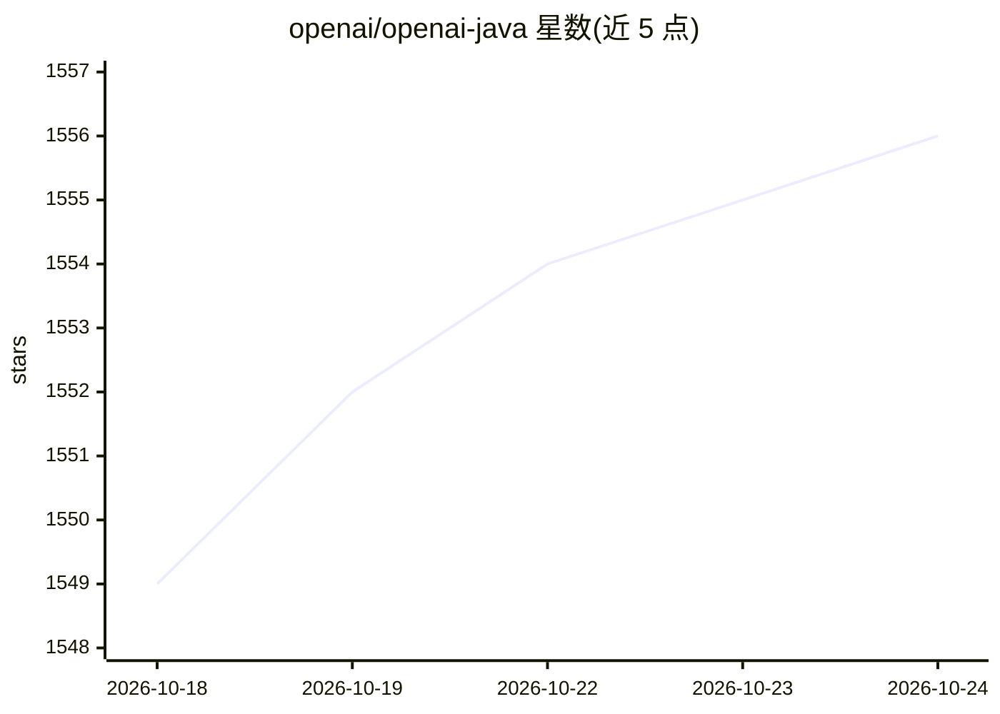

# openai/openai-java

⭐ 1,556 · Kotlin · Apache-2.0 · 推送 2026-10-24 · [GitHub](https://github.com/openai/openai-java) · 组织维护

**OpenAI API 官方 Java SDK：在 Java 应用中调用 OpenAI REST API**

OpenAI 官方维护的 Java 库，封装对 OpenAI REST API 的访问：通过 Responses API 与 Chat Completions API 生成文本，支持流式响应、异步客户端、结构化输出（从 Java 类自动派生 JSON schema 并反序列化为实例）。客户端可通过系统属性、环境变量或代码配置，支持工作负载身份认证（Kubernetes/Azure/GCP 短期令牌、X.509 客户端证书）。另提供可选 openai-java-bedrock 构件，以 AWS 凭证调用 Amazon Bedrock 上的 OpenAI 兼容 API。要求 Java 8+。

## 筛选速览

| 维度 | 判定 | 备注 |
|---|---|---|
| AI 角色 | `ai-ecosystem` | LLM/agent 周边工具 |
| 许可风险 | `permissive` | Apache-2.0 |
| 部署形态 | `None` |  |
| 模型依赖 | locked-api |  |
| 硬件要求 | — | 无带数字的原话,不猜 |
| 安装摩擦 | `medium` | 含编译或系统依赖之一 |
| 成熟度 | — | 结构信号不足 |

## 能力要点

- Responses API 与 Chat Completions API 文本生成，支持流式与异步客户端
- 结构化输出：从任意 Java 类自动派生 JSON schema 并反序列化响应
- 工作负载身份认证（K8s/Azure/GCP 令牌、X.509 证书）替代长期 API key
- 可选 openai-java-bedrock 构件访问 Amazon Bedrock 的 OpenAI 兼容 API

## 适用场景

- 在 Java 服务中集成 OpenAI 模型的文本生成能力
- 用自定义 baseUrl 接入 OpenAI 兼容的第三方或本地推理端点
- 企业云环境中用短期工作负载凭证替代长期 API key

## 场景标签

`模型网关` · 领域:Agent 开发

## 证据(README 行号)

> L6: The OpenAI Java SDK provides convenient access to the OpenAI REST API from applications written in Java.
> L50: The primary API for interacting with OpenAI models is the Responses API. You can generate text from the model with 

## 星数曲线

2026-10-18 1,549 → 2026-10-24 1,556（+7）

---
*卡片 v1 · prompt 1.4 · 生成 2026-10-21 · 置信度 high · 依据 README sha `28ba768b4d86` · [字段定义](../../DATASET.md)*
