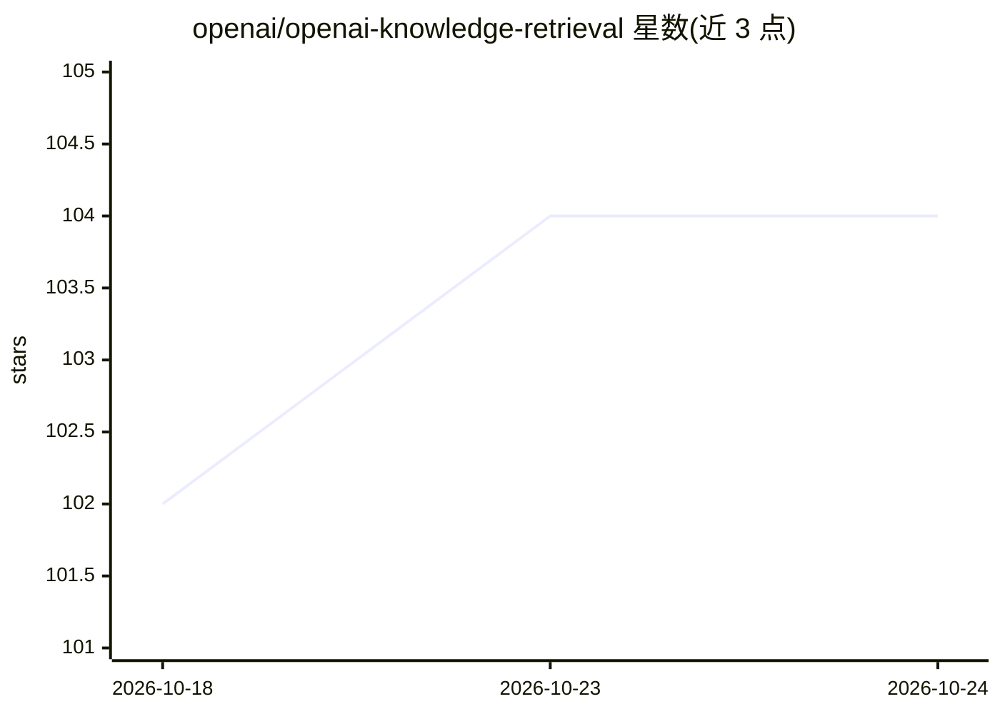

# openai/openai-knowledge-retrieval

⭐ 104 · Python · MIT · 推送 2026-01-13 · [GitHub](https://github.com/openai/openai-knowledge-retrieval) · 组织维护

**OpenAI 官方知识检索 RAG 起步套件：几条命令搭起问答应用**

配置驱动的 RAG starter kit，组合 OpenAI File Search、Chatkit UI 与 OpenAI Evals，提供可插拔的摄取、检索与评测工具链。后端为 Python（Typer CLI + FastAPI），前端为 Vite/React 19；全部流程由 YAML 配置驱动：多种分块策略（recursive/heading/hybrid/xml_aware/custom）、向量存储后端可选托管 File Search 或本地 Qdrant、检索阶段支持查询扩展、HyDE、相似度过滤与 LLM 重排，评测数据集可自动合成或人工提供。需 OpenAI API key 才能使用 File Search 与 Evals。

## 筛选速览

| 维度 | 判定 | 备注 |
|---|---|---|
| AI 角色 | `ai-ecosystem` | LLM/agent 周边工具 |
| 许可风险 | `permissive` | MIT |
| 部署形态 | `None` |  |
| 模型依赖 | — | README 未给出锁定关系 |
| 硬件要求 | — | 无带数字的原话,不猜 |
| 安装摩擦 | `medium` | 含编译或系统依赖之一 |
| 成熟度 | — | 结构信号不足 |

## 能力要点

- YAML-first 配置驱动摄取/检索/合成全流程
- 向量存储支持 OpenAI File Search 或自定义（含 Qdrant 适配器与插件机制）
- 检索管线含查询扩展、HyDE、相似度过滤、LLM 重排四阶段
- 评测框架支持本地评分、合成数据集生成及同步 OpenAI Evals

## 适用场景

- 快速搭建基于自有文档的知识问答应用
- 定制分块策略与向量库后端构建检索管线
- 对 RAG 检索质量做合成数据或人工数据集评测

## 场景标签

`RAG` `模型评测` · 领域:评测与运维

## 证据(README 行号)

> L7: Config-first RAG starter kit that pairs OpenAI File Search, Chatkit, and Evals with a
> L38: - `stores/` – adapters for OpenAI File Search and custom vector stores (Qdrant example included).
> L42: - `evals/` – evaluation harness, dataset generation, and reporters.

## 星数曲线

2026-10-18 102 → 2026-10-24 104（+2）

---
*卡片 v1 · prompt 1.4 · 生成 2026-10-23 · 置信度 high · 依据 README sha `f93b91509a62` · [字段定义](../../DATASET.md)*
