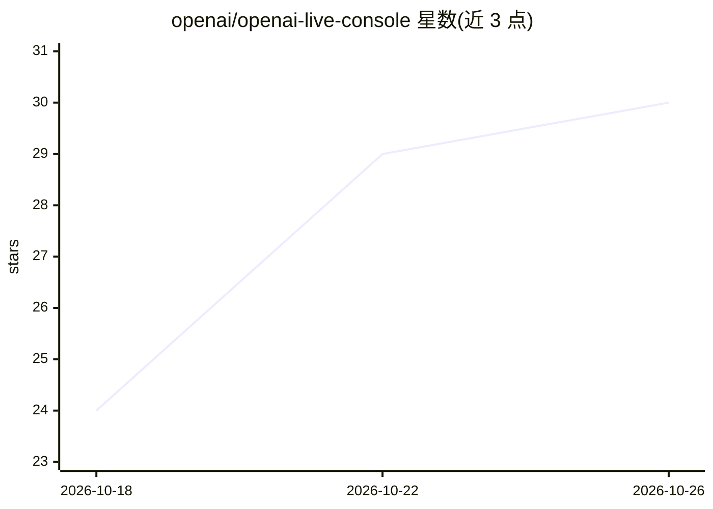

# openai/openai-live-console

⭐ 30 · TypeScript · MIT · 推送 2026-09-12 · [GitHub](https://github.com/openai/openai-live-console) · 组织维护

**面向 gpt-live-1 的本地语音控制台示例，含只读工具与后端委托**

OpenAI 官方提供的本地语音控制台教学示例：用户通过浏览器麦克风与 gpt-live-1（Live WebRTC）对话，围绕一个虚构背包目录提问，应用在校验后执行只读工具调用并展示委托与事件流；支持 Live 托管与应用托管两种委托模式，均不可执行 shell 命令或下单。后端模型默认 gpt-5.4-mini（Responses），使用官方 OpenAI Node SDK 7.9.0。限制：仅 127.0.0.1 本地运行、单会话、API 计费另算，明确声明不是生产级服务。

## 筛选速览

| 维度 | 判定 | 备注 |
|---|---|---|
| AI 角色 | `ai-native` | 本体是模型或模型工具 |
| 许可风险 | `permissive` | MIT |
| 部署形态 | `None` |  |
| 模型依赖 | — | README 未给出锁定关系 |
| 硬件要求 | — | 无带数字的原话,不猜 |
| 安装摩擦 | `low` | 无编译、无系统依赖或容器化 |
| 成熟度 | — | 结构信号不足 |

## 能力要点

- Live WebRTC 语音对话，服务端持有密钥并执行只读工具调用
- 两种委托模式：Managed by Live / Managed by app（含有界工具循环）
- 会话时长守卫、请求频次与工具调用数量限制（单会话、每分钟 6 次启动等）
- loopback 绑定、Host/Origin 校验、CSRF 验证等本地安全措施

## 适用场景

- 学习 Live WebRTC 与后端委托模式的集成方式
- 在本地体验带只读工具调用的语音对话流程
- 参考其服务端密钥管理与本地安全实现做二次开发

## 场景标签

 · 领域:语音 AI 应用/示例项目

## 证据(README 行号)

> L3: A local voice console with a visible backend. Talk about a small fictional backpack catalog, see delegation and read
> L5: The application targets `gpt-live-1` and requires an API project with access to Live WebRTC, sideband attachment, an
> L35: |Mode|Live owns|This application owns|

## 星数曲线

2026-10-18 24 → 2026-10-26 30（+6）

---
*卡片 v1 · prompt 1.4 · 生成 2026-10-26 · 置信度 high · 依据 README sha `72a207842ed2` · [字段定义](../../DATASET.md)*
