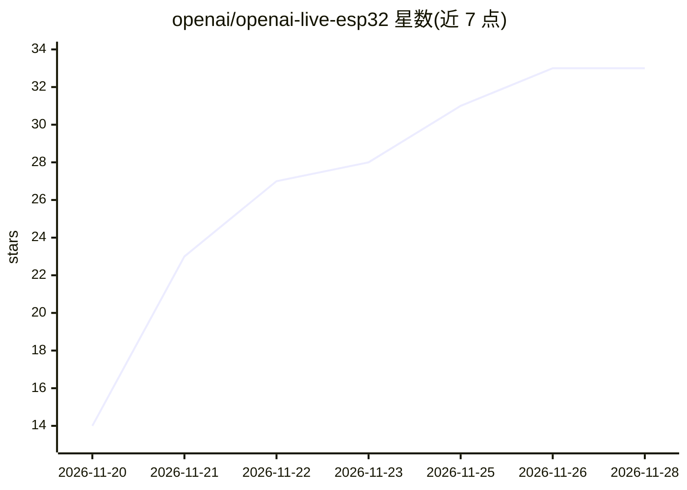

# openai/openai-live-esp32

⭐ 33 · C · Apache-2.0 · 推送 2026-11-23 · [GitHub](https://github.com/openai/openai-live-esp32) · 组织维护

**在 ESP32-S3 开发板上通过 OpenAI Live API 构建语音助手**

面向嵌入式开发者的实验性 SDK，含两部分：可移植 C 协议库与 ESP-IDF WebRTC/Opus 适配器，处理 Live 会话、WebRTC 传输与音频流（24 kHz 16-bit 单声道 PCM）；另为 Waveshare、M5Stack CoreS3、StackChan、ESP-Mosaico、Sonatino 等具体开发板提供语音应用示例。支持配置系统提示词、开场语音、函数工具与托管 web search，前端语音模型默认 gpt-live-1，后端委托 Responses 模型。项目自述为概念验证，无稳定性保证，OpenAI 不提供官方支持。

## 筛选速览

| 维度 | 判定 | 备注 |
|---|---|---|
| AI 角色 | `ai-native` | 本体是模型或模型工具 |
| 许可风险 | `permissive` | Apache-2.0 |
| 部署形态 | `None` |  |
| 模型依赖 | — | README 未给出锁定关系 |
| 硬件要求 | — | 无带数字的原话,不猜 |
| 安装摩擦 | `medium` | 含编译或系统依赖之一 |
| 成熟度 | `idea` | |

## 能力要点

- 可移植 C 协议库 + ESP-IDF WebRTC/Opus 适配器的双层结构
- 支持自定义系统提示词、开场语音、函数工具与托管 web search
- 为多款 Waveshare/M5Stack/Sonatino 开发板提供可运行示例应用
- 通过公网 Live WebRTC JSON offer/answer 协议连接 api.openai.com

## 适用场景

- 在支持的 ESP32 开发板上搭建语音助手设备
- 为自己的 ESP32 项目适配音频驱动与 Live 协议
- 在机器人（StackChan）上接入语音控制的摄像头与舵机动作

## 场景标签

`语音 Agent` · 领域:对话与助手

## 证据(README 行号)

> L6: Build a voice assistant with the OpenAI Live API
> L9: 1. **Core SDK:** a portable C protocol library and an ESP-IDF WebRTC/Opus adapter.
> L141: The ESP-IDF adapter targets dual-core **ESP32-S3 boards with PSRAM** and

## 星数曲线

2026-11-20 14 → 2026-11-28 33（+19）

---
*卡片 v1 · prompt 1.4 · 生成 2026-11-20 · 置信度 high · 依据 README sha `1125064e628c` · [字段定义](../../DATASET.md)*
