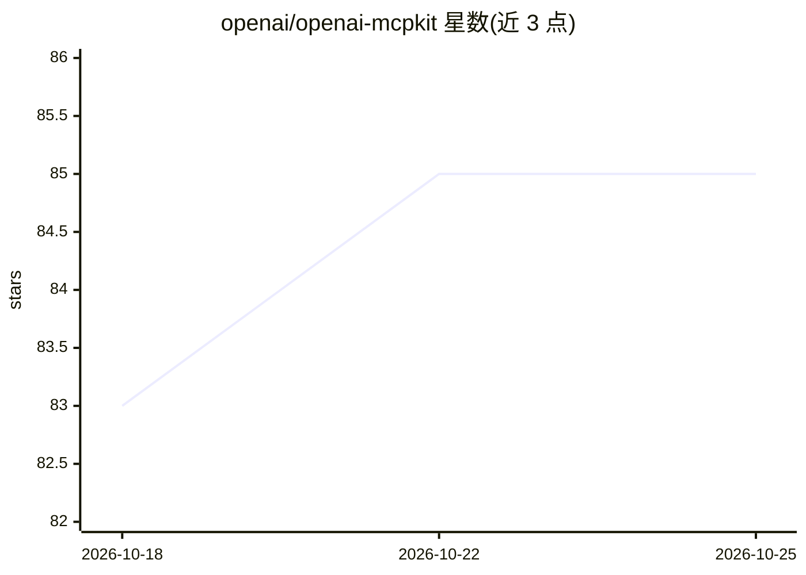

# openai/openai-mcpkit

⭐ 86 · Python · 推送 2026-08-07 · [GitHub](https://github.com/openai/openai-mcpkit) · 组织维护

**企业级带认证 MCP 服务器脚手架，向 ChatGPT 接入专有数据**

OpenAI 维护的 Model Context Protocol 服务器构建蓝图：提供 Python 与 TypeScript 两种带认证的服务器脚手架，实现 Deep Research 兼容的 search/fetch 工具、权限（entitlement）检查，以及资源服务器与授权服务器分离的 MCP 授权模式。示例授权服务使用 Auth0，可替换为任意 OIDC 兼容提供商（Okta、Azure AD 等）。附金融替代数据合成数据包供演示。面向需要将专有数据接入 ChatGPT（Dev Mode）的企业开发者，本地开发需配合 ngrok 隧道。

## 筛选速览

| 维度 | 判定 | 备注 |
|---|---|---|
| AI 角色 | `ai-ecosystem` | LLM/agent 周边工具 |
| 许可风险 | `none` | — |
| 部署形态 | `None` |  |
| 模型依赖 | — | README 未给出锁定关系 |
| 硬件要求 | — | 无带数字的原话,不猜 |
| 安装摩擦 | `low` | 无编译、无系统依赖或容器化 |
| 成熟度 | — | 结构信号不足 |

## 能力要点

- Python 与 TypeScript 带认证 MCP 服务器脚手架，含 Deep Research 兼容 search/fetch 工具
- 实现资源/授权服务器分离的 MCP 授权规范模式与 entitlement 检查
- Auth0 端到端集成，可替换为任意 OIDC 兼容提供商
- 附 synthetic_financial_data 合成数据包用于演示

## 适用场景

- 把内部研究报告、CRM 知识库等专有数据接入 ChatGPT
- 在自有认证与授权规则下向 LLM 暴露敏感数据
- 按金融、客服、医疗、电商场景定制 MCP 服务器

## 场景标签

 · 领域:LLM 基础设施/MCP 服务器

## 证据(README 行号)

> L3: MCPKit is a blueprint for building authenticated Model Context Protocol (MCP) servers that let you bring proprietary
> L25: - **Authenticated MCP server scaffolds:** Python and TypeScript servers that implement a number of different tools,

## 星数曲线

2026-10-18 83 → 2026-10-25 85（+2）

---
*卡片 v1 · prompt 1.4 · 生成 2026-10-24 · 置信度 high · 依据 README sha `41d1a69d7922` · [字段定义](../../DATASET.md)*
