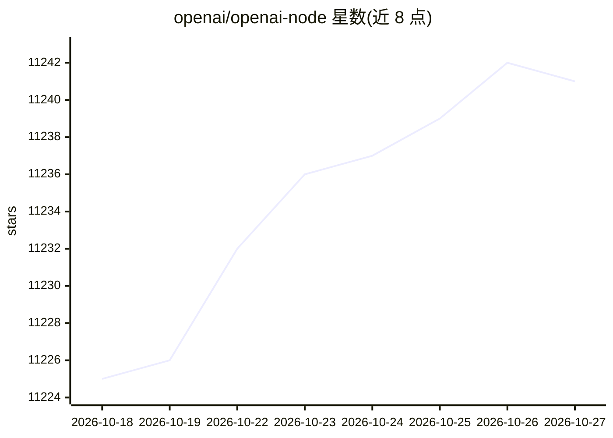

# openai/openai-node

⭐ 11,241 · TypeScript · Apache-2.0 · 推送 2026-10-26 · [GitHub](https://github.com/openai/openai-node) · [官网](https://www.npmjs.com/package/openai) · 组织维护

**OpenAI API 官方 TypeScript/JavaScript SDK，供开发者调用 OpenAI 模型服务**

由 OpenAI 官方维护的 TypeScript/JavaScript 库，从 OpenAPI 规范自动生成，提供对 OpenAI REST API 的访问：Responses API 与 Chat Completions 文本生成、图像分析、流式 SSE 响应、文件上传、Webhook 验签、自动重试与超时控制、自动分页、Realtime WebSocket 多模态会话，以及 Workload Identity 认证（Kubernetes/Azure/GCP/X.509）。面向在 Node.js/Deno 环境中接入 OpenAI 及 Azure OpenAI、Amazon Bedrock 的开发者，通过 npm 安装。

## 筛选速览

| 维度 | 判定 | 备注 |
|---|---|---|
| AI 角色 | `ai-ecosystem` | LLM/agent 周边工具 |
| 许可风险 | `permissive` | Apache-2.0 |
| 部署形态 | `library` | 以包/库形式分发 |
| 模型依赖 | locked-api |  |
| 硬件要求 | — | 无带数字的原话,不猜 |
| 安装摩擦 | `low` | 无编译、无系统依赖或容器化 |
| 成熟度 | — | 结构信号不足 |

## 能力要点

- 支持 Responses API 与 Chat Completions 文本生成、流式 SSE 响应
- Workload Identity 认证：Kubernetes/Azure/GCP 短时令牌与 X.509 客户端证书
- 内置 Webhook 签名验证、自动重试（默认 2 次指数退避）、自动分页
- Realtime API WebSocket 连接，支持文本/音频输入输出与函数调用

## 适用场景

- 在 Node.js/TypeScript 项目中调用 OpenAI 模型生成文本
- 构建低延迟多模态实时会话应用
- 在云托管环境（Kubernetes/Azure/GCP）中免 API key 认证接入 OpenAI

## 场景标签

 · 领域:LLM 基础设施/API SDK

## 证据(README 行号)

> L5: This library provides convenient access to the OpenAI REST API from TypeScript or JavaScript.
> L7: It is generated from our OpenAPI specification.

## 星数曲线

2026-10-18 11,225 → 2026-10-27 11,241（+16）

---
*卡片 v1 · prompt 1.4 · 生成 2026-10-20 · 置信度 high · 依据 README sha `0aa6c3426dd1` · [字段定义](../../DATASET.md)*
