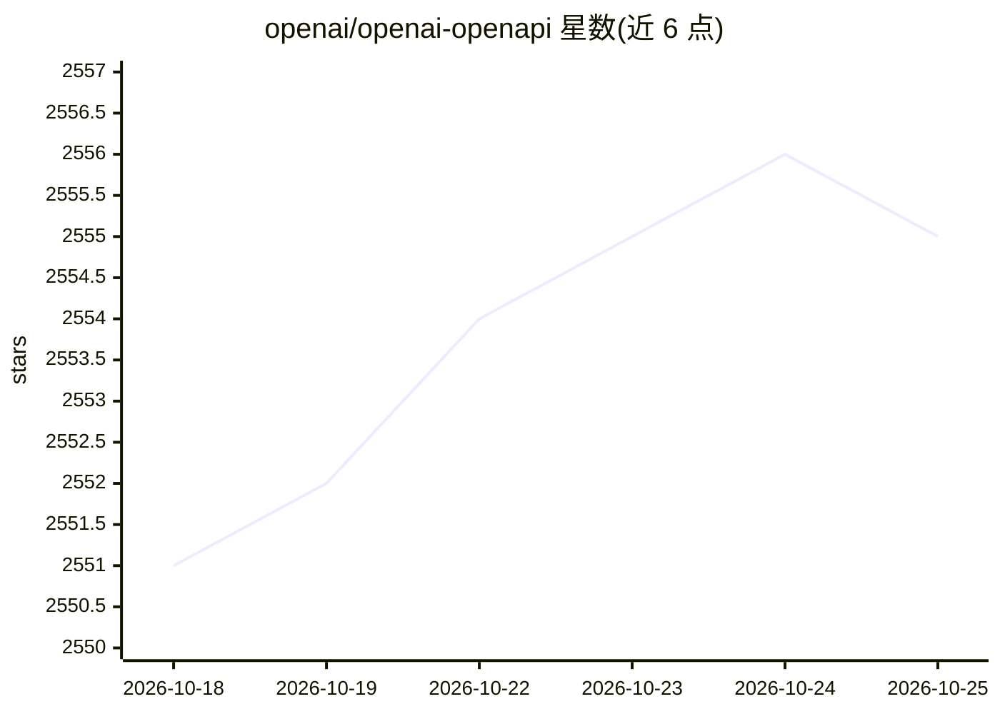

# openai/openai-openapi

⭐ 2,558 · MIT · 推送 2026-10-24 · [GitHub](https://github.com/openai/openai-openapi) · [官网](https://platform.openai.com/docs/api-reference/introduction) · 组织维护

**OpenAI REST API 的 OpenAPI 3.1 规范文档仓库**

以 OpenAPI 3.1 编写的机器可读规范，描述 OpenAI REST API 的端点、认证、参数及请求/响应 schema。openapi.yaml 与 openapi.json 为自动同步自上游源码的生成产物，不接受直接修改的贡献流程，问题通过 issue 反馈。用途包括生成类型化客户端、构建 API 浏览器、配置测试工具；README 列出由此规范生成的 7 个官方 SDK 仓库（Python/Node/.NET/Go/Java/Ruby 等）。MIT 许可。

## 筛选速览

| 维度 | 判定 | 备注 |
|---|---|---|
| AI 角色 | `ai-ecosystem` | LLM/agent 周边工具 |
| 许可风险 | `permissive` | MIT |
| 部署形态 | `None` |  |
| 模型依赖 | — | README 未给出锁定关系 |
| 硬件要求 | — | 无带数字的原话,不猜 |
| 安装摩擦 | `medium` | 含编译或系统依赖之一 |
| 成熟度 | — | 结构信号不足 |

## 能力要点

- OpenAPI 3.1 规范描述 OpenAI REST API 端点与 schema
- yaml/json 为自动同步的生成产物，问题走 issue 反馈流程
- 列出 7 个由该规范生成的官方 SDK 仓库
- MIT 许可

## 适用场景

- 基于规范生成或校验 OpenAI API 的类型化客户端
- 将规范导入 OpenAPI 兼容工具做 API 探索或测试
- 查阅 OpenAI API 的机器可读接口定义

## 场景标签

 · 领域:LLM 基础设施/API 规范

## 证据(README 行号)

> L3:  A machine-readable description of the OpenAI REST API, authored in OpenAPI 3.1.
> L15: This repository publishes the OpenAPI specification for the OpenAI API. The spec describes the API's endpoints, aut
> L19: Use it to generate typed clients, build API explorers, configure testing tools, or work with the OpenAI API in any 

## 星数曲线

2026-10-18 2,551 → 2026-10-25 2,555（+4）

---
*卡片 v1 · prompt 1.4 · 生成 2026-10-21 · 置信度 high · 依据 README sha `37fe8e3ac9fa` · [字段定义](../../DATASET.md)*
