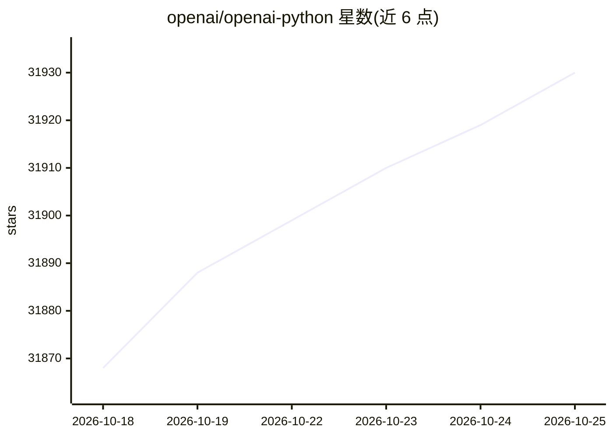

# openai/openai-python

⭐ 31,946 · Python · Apache-2.0 · 推送 2026-10-25 · [GitHub](https://github.com/openai/openai-python) · [官网](https://pypi.org/project/openai/) · 组织维护

**OpenAI API 官方 Python 客户端库**

面向 Python 3.10+ 应用的 OpenAI REST API 官方 SDK，由 OpenAPI 规范生成，包含全部请求参数与响应字段的类型定义，提供同步与异步客户端。功能覆盖 Responses API、Chat Completions、流式响应（SSE）、Realtime API（WebSocket 音视频对话）、视觉输入、自动分页、文件上传与 Webhook 签名校验；支持 API key、Kubernetes/Azure/GCP 工作负载身份及 X.509 mTLS 多种认证方式，错误按状态码映射为类型化异常。

## 筛选速览

| 维度 | 判定 | 备注 |
|---|---|---|
| AI 角色 | `ai-ecosystem` | LLM/agent 周边工具 |
| 许可风险 | `permissive` | Apache-2.0 |
| 部署形态 | `library` | 以包/库形式分发 |
| 模型依赖 | — | README 未给出锁定关系 |
| 硬件要求 | — | 无带数字的原话,不猜 |
| 安装摩擦 | `low` | 无编译、无系统依赖或容器化 |
| 成熟度 | — | 结构信号不足 |

## 动量与使用信号

- 维护:`active` — 距上次 push 1.0 天,年发版 100,199 位贡献者
- 涨星:近 1 天 **+7**(自 20261016 起算)
- 安装:pypi 包 `openai` 月下载 295,856,631
- 平台:— · 协议:OPENAI-API

## 能力要点

- 同步与异步客户端，HTTPX2 默认传输，可选 aiohttp
- 支持 SSE 流式与 Realtime WebSocket 多模态会话
- 多认证方式：API key、K8s/Azure/GCP 工作负载身份、X.509 mTLS
- 自动分页迭代器与 TypedDict/Pydantic 类型定义

## 适用场景

- 在 Python 应用中调用 OpenAI 模型生成文本或处理图像
- 构建低延迟多模态语音/文本实时对话应用
- 在云托管环境中用工作负载身份短时令牌替代长期 API key
- 接收并校验 OpenAI Webhook 回调事件

## 场景标签

 · 领域:LLM 基础设施/SDK

## 证据(README 行号)

> L5: The OpenAI Python library provides convenient access to the OpenAI REST API from any Python 3.10+
> L9: It is generated from our OpenAPI specification.
> L19: pip install openai

## 星数曲线

2026-10-18 31,868 → 2026-10-25 31,930（+62）

---
*卡片 v1 · prompt 1.4 · 生成 2026-10-18 · 置信度 high · 依据 README sha `a288f6af6173` · [字段定义](../../DATASET.md)*
