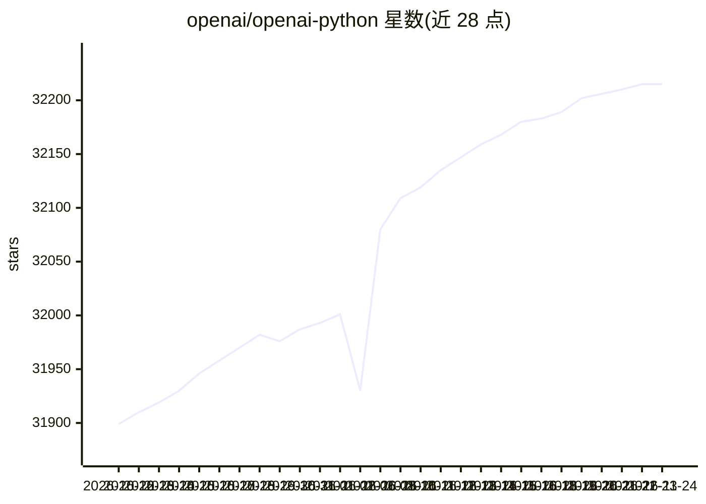

# openai/openai-python

⭐ 32,223 · Python · Apache-2.0 · 推送 2026-11-24 · [GitHub](https://github.com/openai/openai-python) · [官网](https://pypi.org/project/openai/) · 组织维护

**开发者接入 OpenAI REST API 的官方 Python SDK**

OpenAI 官方 Python 库，供 Python 3.10+ 应用访问 OpenAI REST API。由 OpenAPI 规范生成，提供全部请求参数与响应字段的类型定义，内置同步与异步（HTTPX2）客户端。覆盖文本生成（Responses API 与 Chat Completions API）、视觉输入、SSE 流式响应、Realtime WebSocket 语音会话、自动分页、文件上传、webhook 签名校验，以及 API key、Kubernetes/Azure/GCP workload identity 与 X.509 mTLS 等多种认证方式。通过 PyPI 安装，aiohttp 为可选传输。

## 筛选速览

| 维度 | 判定 | 备注 |
|---|---|---|
| AI 角色 | `ai-ecosystem` | LLM/agent 周边工具 |
| 许可风险 | `permissive` | Apache-2.0 |
| 部署形态 | `library` | 以包/库形式分发 |
| 模型依赖 | — | README 未给出锁定关系 |
| 硬件要求 | — | 无带数字的原话,不猜 |
| 安装摩擦 | `low` | 无编译、无系统依赖或容器化 |
| 成熟度 | — | 结构信号不足 |

## 动量与使用信号

- 维护:`active` — 距上次 push 1.0 天,年发版 100,199 位贡献者
- 涨星:近 1 天 **+7**(自 20261016 起算)
- 安装:pypi 包 `openai` 月下载 295,856,631
- 平台:— · 协议:OPENAI-API

## 能力要点

- 从 OpenAPI 规范生成，全部请求/响应带类型定义（TypedDict/Pydantic）
- 同步与异步客户端，支持 aiohttp 可选传输与 SSE 流式响应
- 多种认证：API key、Kubernetes/Azure/GCP workload identity、X.509 mTLS
- Realtime API（WebSocket 文本/音频）、自动分页与文件上传支持

## 适用场景

- 在 Python 应用中调用 OpenAI 模型生成文本或分析图像
- 构建低延迟多模态实时对话应用（文本/音频输入输出）
- 在云端自动化环境中用短期令牌替代长期 API key 访问 API
- 处理 OpenAI webhook 事件并校验签名

## 场景标签

 · 领域:AI 开发工具/SDK

## 证据(README 行号)

> L5: The OpenAI Python library provides convenient access to the OpenAI REST API from any Python 3.10+
> L26: The primary API for interacting with OpenAI models is the Responses API. You can generate text from the model with 

## 星数曲线

2026-10-22 31,899 → 2026-11-24 32,215（+316）

---
*卡片 v1 · prompt 1.4 · 生成 2026-11-24 · 置信度 high · 依据 README sha `1c242ba31ac0` · [字段定义](../../DATASET.md)*
