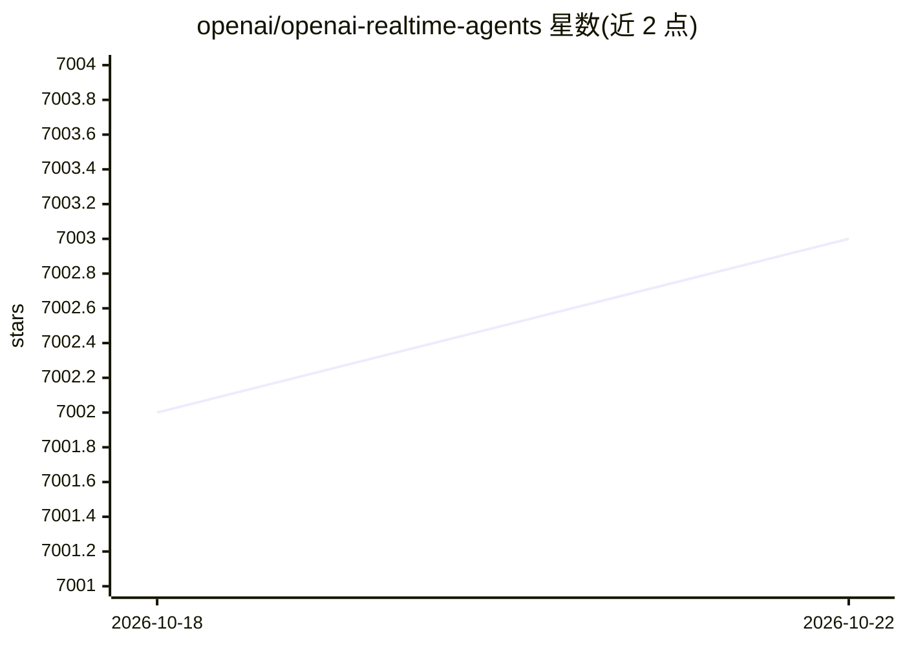

# openai/openai-realtime-agents

⭐ 7,005 · TypeScript · MIT · 推送 2026-01-07 · [GitHub](https://github.com/openai/openai-realtime-agents) · 组织维护

**基于 OpenAI Realtime API 的语音 agent 模式演示应用**

OpenAI 官方维护的 Next.js TypeScript 演示项目，展示构建在 Realtime API 与 OpenAI Agents SDK 之上的两种语音 agent 架构模式：Chat-Supervisor（实时语音聊天 agent 配合文本 supervisor 模型处理工具调用与复杂回复）与 Sequential Handoff（专业 agent 间按意图顺序转移用户）。内置客服零售示例流程，含身份认证、退货、销售等 agent 图与输出安全护栏；README 说明如何复制模板开发自己的多 agent 语音应用，运行需配置 OPENAI_API_KEY。

## 筛选速览

| 维度 | 判定 | 备注 |
|---|---|---|
| AI 角色 | `ai-ecosystem` | LLM/agent 周边工具 |
| 许可风险 | `permissive` | MIT |
| 部署形态 | `library` | 以包/库形式分发 |
| 模型依赖 | — | README 未给出锁定关系 |
| 硬件要求 | — | 无带数字的原话,不猜 |
| 安装摩擦 | `low` | 无编译、无系统依赖或容器化 |
| 成熟度 | — | 结构信号不足 |

## 能力要点

- 两种 agent 模式：Chat-Supervisor 与 Sequential Handoff
- 基于 OpenAI Agents SDK 的 agent 定义、工具集成与多 agent 协作
- 客服零售示例流程：认证/退货/销售 agent 图与 o4-mini 升级决策
- 输出护栏：助手消息经安全合规检查后才展示（IN_PROGRESS/FAIL/PASS）

## 适用场景

- 学习语音 agent 的 supervisor 与 handoff 架构模式
- 以此为模板快速搭建自己的多 agent 实时语音应用原型
- 观察客服场景中 agent 转移、工具调用与事件流的完整交互

## 场景标签

`语音 Agent` `多智能体` · 领域:Agent 开发

## 证据(README 行号)

> L3: This is a demonstration of more advanced patterns for voice agents, using the OpenAI Realtime API and the OpenAI Age
> L113: - You can copy these templates to make your own multi-agent voice app! Once you make a new agent set config, add i

## 星数曲线

2026-10-18 7,002 → 2026-10-22 7,003（+1）

---
*卡片 v1 · prompt 1.4 · 生成 2026-10-20 · 置信度 high · 依据 README sha `5350d2f40920` · [字段定义](../../DATASET.md)*
