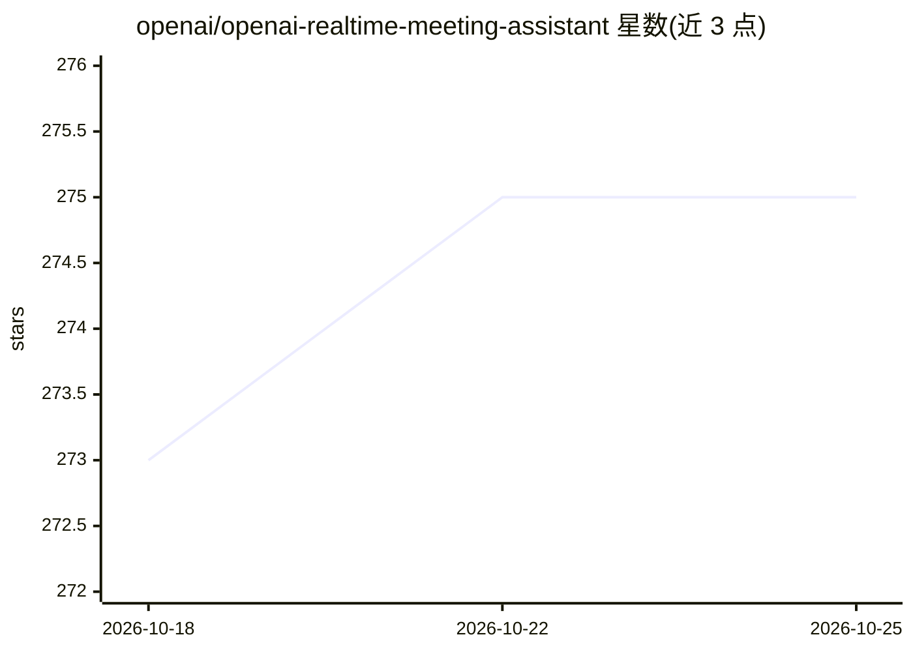

# openai/openai-realtime-meeting-assistant

⭐ 276 · Go · MIT · 推送 2026-05-11 · [GitHub](https://github.com/openai/openai-realtime-meeting-assistant) · 组织维护

**用语音操作共享 Kanban 看板的 OpenAI Realtime API 演示应用**

OpenAI 官方示例：基于 Go 与 Pion WebRTC 的多人站会应用，多名用户加入同一 WebRTC 房间，服务器混音各参与者音频发送给 OpenAI Realtime 对端，通过函数调用驱动共享 Kanban 看板更新（建卡、移动、打标签、改标题/备注、删卡）。面向想了解 Realtime + WebRTC 集成与函数调用的开发者，初始卡片、指令、工具与模型（默认 gpt-realtime-2）均可在源码中自定义。注意：演示不含身份认证，环境变量需手动 export，不自动加载 .env。

## 筛选速览

| 维度 | 判定 | 备注 |
|---|---|---|
| AI 角色 | `ai-native` | 本体是模型或模型工具 |
| 许可风险 | `permissive` | MIT |
| 部署形态 | `None` |  |
| 模型依赖 | — | README 未给出锁定关系 |
| 硬件要求 | — | 无带数字的原话,不猜 |
| 安装摩擦 | `low` | 无编译、无系统依赖或容器化 |
| 成熟度 | — | 结构信号不足 |

## 能力要点

- 多人 WebRTC 房间音频混音后发送给 Realtime 对端
- 函数调用驱动看板操作（建/移/标签/改/删）
- 默认使用 gpt-realtime-2，可用 OPENAI_REALTIME_MODEL 更换
- 初始卡片、模型指令与工具集在 kanban.go 中可自定义

## 适用场景

- 站会时用自然语音更新共享 Kanban 看板
- 学习 Realtime API 与 WebRTC、函数调用的集成方式
- 作为模板定制自己的语音会议助手

## 场景标签

`语音 Agent` · 领域:对话与助手

## 证据(README 行号)

> L8: This demo showcases how to use the OpenAI Realtime API to interact through voice with a Kanban board during a standu
> L10: It is implemented as a Go application using Pion WebRTC, Gorilla WebSocket, Opus audio encoding/decoding, and the R
> L94: - Create tickets from explicit requests or concrete standup updates.

## 星数曲线

2026-10-18 273 → 2026-10-25 275（+2）

---
*卡片 v1 · prompt 1.4 · 生成 2026-10-22 · 置信度 high · 依据 README sha `415c6b8e783f` · [字段定义](../../DATASET.md)*
