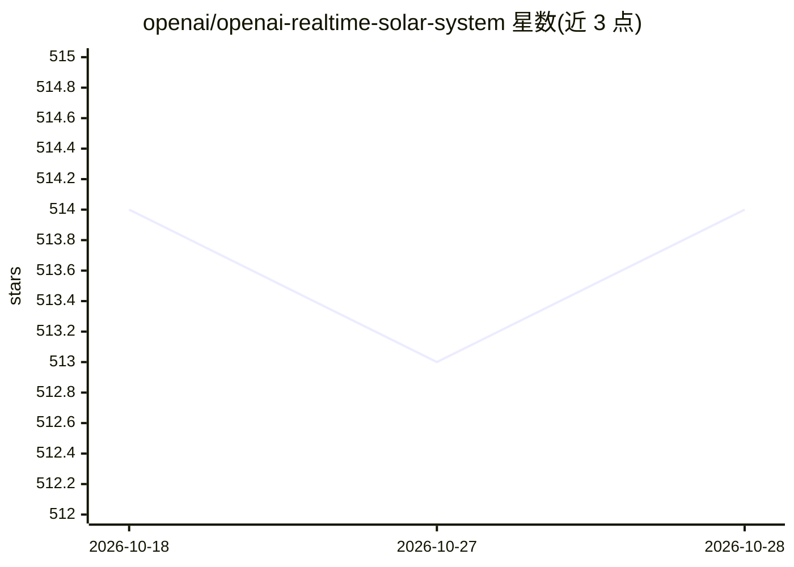

# openai/openai-realtime-solar-system

⭐ 514 · TypeScript · MIT · 推送 2026-03-04 · [GitHub](https://github.com/openai/openai-realtime-solar-system) · 组织维护

**语音驱动的 3D 太阳系交互 Demo：用 Realtime API 声控场景**

OpenAI 官方演示项目，展示如何通过 Realtime API 与 WebRTC 集成，用语音对话操控 Spline 构建的 3D 太阳系场景。模型通过 function calling 调用应用内工具，触发行星聚焦、卫星显示、图表展示、ISS 位置获取、相机切换等动画。基于 NextJS 实现，需配置 OPENAI_API_KEY，npm 安装依赖后本地运行；指令、工具与语音可在 lib/config.ts 中自定义，场景可替换为自建 Spline 场景。

## 筛选速览

| 维度 | 判定 | 备注 |
|---|---|---|
| AI 角色 | `ai-ecosystem` | LLM/agent 周边工具 |
| 许可风险 | `permissive` | MIT |
| 部署形态 | `library` | 以包/库形式分发 |
| 模型依赖 | — | README 未给出锁定关系 |
| 硬件要求 | — | 无带数字的原话,不猜 |
| 安装摩擦 | `low` | 无编译、无系统依赖或容器化 |
| 成熟度 | — | 结构信号不足 |

## 能力要点

- Realtime API + WebRTC 实时语音对话
- function calling 映射到 3D 场景动画（行星聚焦/卫星/轨道视角）
- 支持图表展示与 ISS 位置实时获取
- 场景、指令、工具、语音均可自定义替换

## 适用场景

- 学习 Realtime API 与 function calling 的集成方式
- 参考如何用 LLM 工具调用驱动 3D 场景交互
- 体验语音操控的太阳系可视化 Demo

## 场景标签

`语音 Agent` `教程课程` · 领域:对话与助手

## 证据(README 行号)

> L7: This demo showcases how to use the OpenAI Realtime API to interact through voice with a 3D scene (built with Spline)
> L9: It is implemented using the Realtime + WebRTC integration and uses function calling to trigger actions in the app.

## 星数曲线

2026-10-18 514 → 2026-10-28 514（+0）

---
*卡片 v1 · prompt 1.4 · 生成 2026-10-21 · 置信度 high · 依据 README sha `df78b6d05a66` · [字段定义](../../DATASET.md)*
