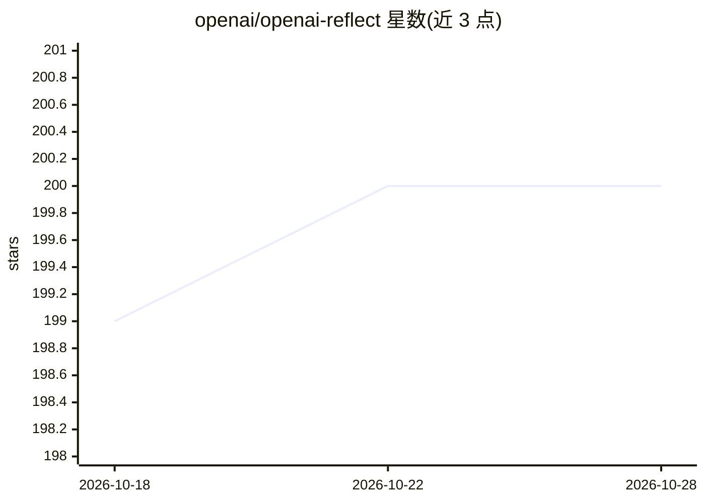

# openai/openai-reflect

⭐ 200 · C++ · MIT · 推送 2026-03-27 · [GitHub](https://github.com/openai/openai-reflect) · 组织维护

**ESP32 硬件 AI 语音助手 demo：声光交互、手机持钥**

OpenAI 黑客松产出的实体 AI 助手项目：运行于 espressif（ESP32S3）微控制器设备，通过声音、灯光与颜色进行自然语言交互，设计上避免屏幕；设备本身不保存状态，信息存于手机并以手机作为密钥。功能构想包括日历回顾、日程准备、学习时播放音乐与位置感知行为。当前面向 M5Stack CoreS3 开发板与 LIFX 彩色灯泡，通过 esp-idf 工具链编译烧录，设备创建 WiFi 热点供网页会话接入并连接 Realtime API 音频。README 明确声明为 demo/as-is 项目，未经充分安全与可靠性审查。

## 筛选速览

| 维度 | 判定 | 备注 |
|---|---|---|
| AI 角色 | `ai-native` | 本体是模型或模型工具 |
| 许可风险 | `permissive` | MIT |
| 部署形态 | `None` |  |
| 模型依赖 | — | README 未给出锁定关系 |
| 硬件要求 | — | 无带数字的原话,不猜 |
| 安装摩擦 | `low` | 无编译、无系统依赖或容器化 |
| 成熟度 | `idea` | |

## 能力要点

- 运行于 ESP32S3 微控制器的声光交互 AI 助手
- 设备无状态设计，信息存于手机并以手机为密钥
- 支持 M5Stack CoreS3 与 LIFX Color A19 灯泡
- 设备创建 WiFi 热点 reflect，网页端接入 Realtime API 音频会话

## 适用场景

- 在桌面等场景放置一个无屏幕的语音 AI 助手设备
- 结合日历做昨日回顾与明日准备
- 按位置（厨房/办公室）触发不同的助手行为
- 基于 esp-idf 修改与扩展设备固件

## 场景标签

`语音 Agent` · 领域:对话与助手

## 证据(README 行号)

> L6: **Reflect** is a hardware AI Assistant that was built during a OpenAI hackathon.
> L78: If you connected successfully you will see two audio elements on the page. One for Realtime API audio

## 星数曲线

2026-10-18 199 → 2026-10-28 200（+1）

---
*卡片 v1 · prompt 1.4 · 生成 2026-10-22 · 置信度 high · 依据 README sha `1cd4d619e44b` · [字段定义](../../DATASET.md)*
