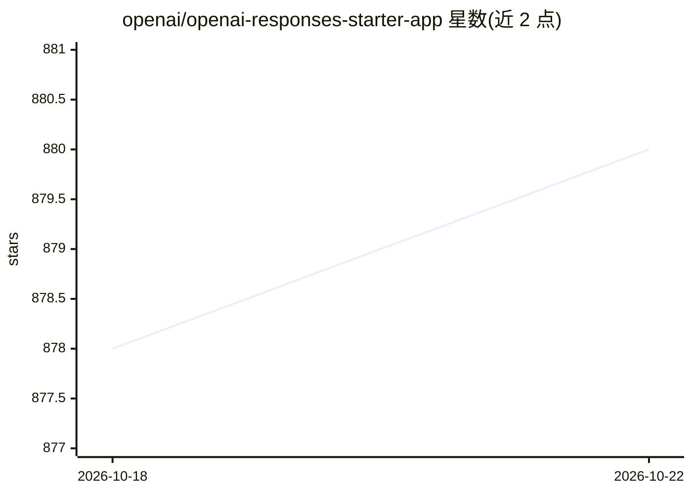

# openai/openai-responses-starter-app

⭐ 880 · TypeScript · NOASSERTION · 推送 2025-12-15 · [GitHub](https://github.com/openai/openai-responses-starter-app) · 组织维护

**基于 OpenAI Responses API 的 NextJS 对话助手起始模板**

OpenAI 官方维护的 NextJS 起始应用，演示 Responses API 的用法：多轮对话、流式输出、函数调用、注释展示，以及可从 UI 配置的内置工具（文件搜索/向量库、网页搜索、代码解释器）、公共 MCP 服务器和 Google Calendar/Gmail 一方连接器（OAuth 流程）。附带 get_weather、get_joke 示例自定义函数，可通过 config/functions.ts 扩展。面向希望快速搭建可定制对话助手的开发者，通过 git clone、npm install、npm run dev 运行，需要设置 OPENAI_API_KEY 环境变量。computer use 与图像生成等内置工具未在本演示中实现。

## 筛选速览

| 维度 | 判定 | 备注 |
|---|---|---|
| AI 角色 | `ai-ecosystem` | LLM/agent 周边工具 |
| 许可风险 | `none` | NOASSERTION |
| 部署形态 | `library` | 以包/库形式分发 |
| 模型依赖 | — | README 未给出锁定关系 |
| 硬件要求 | — | 无带数字的原话,不猜 |
| 安装摩擦 | `low` | 无编译、无系统依赖或容器化 |
| 成熟度 | — | 结构信号不足 |

## 能力要点

- 多轮对话、流式响应与工具调用的聊天界面实现
- 内置工具 UI 配置：文件搜索（向量库创建与文件上传）、网页搜索、代码解释器
- 公共 MCP 服务器配置与自定义函数扩展（config/functions.ts）
- Google Calendar/Gmail 一方连接器集成（OAuth 令牌按会话存储）

## 适用场景

- 基于 Responses API 快速搭建自己的对话助手
- 学习内置工具、MCP 与一方连接器的接入方式
- 在此基础上扩展自定义函数与企业内部工具

## 场景标签

`聊天机器人` · 领域:对话与助手

## 证据(README 行号)

> L7: This repository contains a NextJS starter app built on top of the Responses API.
> L21: This app is meant to be used as a starting point to build a conversational assistant that you can customize to your

## 星数曲线

2026-10-18 878 → 2026-10-22 880（+2）

---
*卡片 v1 · prompt 1.4 · 生成 2026-10-21 · 置信度 high · 依据 README sha `80ffb3fc28cc` · [字段定义](../../DATASET.md)*
