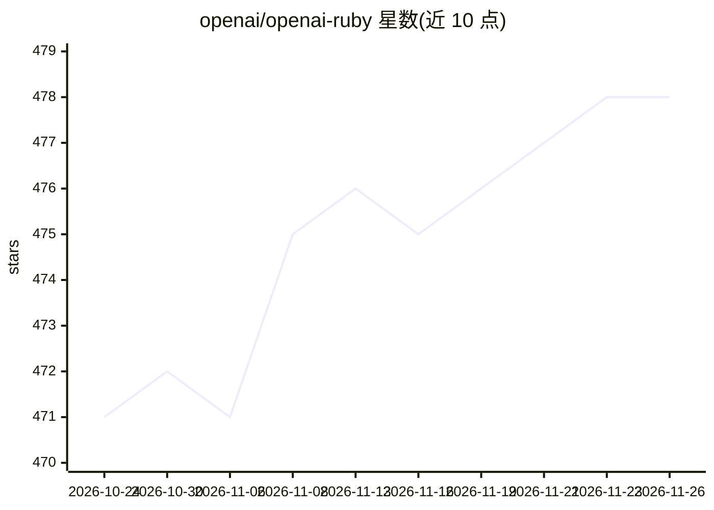

# openai/openai-ruby

⭐ 478 · Ruby · Apache-2.0 · 推送 2026-11-25 · [GitHub](https://github.com/openai/openai-ruby) · 组织维护

**OpenAI API 的官方 Ruby SDK，供 Ruby 应用接入**

官方 Ruby 库，从 Ruby 3.3.0+ 应用访问 OpenAI REST API，自带 Yard/RBS/RBI 类型与文档。提供 SSE 流式响应、Chat Completions 工具自动运行器（回调顺序执行、校验、max_rounds 限制）、Agents 会话与结构化输出解析（beta）、Realtime/Responses WebSocket 会话、自动分页迭代器、文件上传与轮询/向量库批量摄取辅助、可注入的自定义 HTTP 客户端与 mTLS 支持。安装需通过 Bundler 加入 Gemfile；WebSocket 连接需可选 async-websocket gem。

## 筛选速览

| 维度 | 判定 | 备注 |
|---|---|---|
| AI 角色 | `ai-ecosystem` | LLM/agent 周边工具 |
| 许可风险 | `permissive` | Apache-2.0 |
| 部署形态 | `None` |  |
| 模型依赖 | locked-api |  |
| 硬件要求 | — | 无带数字的原话,不猜 |
| 安装摩擦 | `low` | 无编译、无系统依赖或容器化 |
| 成熟度 | — | 结构信号不足 |

## 能力要点

- SSE 流式响应与自动分页迭代器
- Chat Completions 工具运行器：自动执行回调并回传结果
- Realtime 与 Responses 的 WebSocket 会话支持
- 文件上传、处理轮询与向量库批量摄取辅助

## 适用场景

- 在 Ruby 后端中调用 OpenAI 模型生成与对话
- 实现带函数工具调用的 Agent 流程
- 构建实时语音/转写的服务端会话
- 批量上传文件并摄取到向量存储

## 场景标签

`模型网关` · 领域:Agent 开发

## 证据(README 行号)

> L1: # OpenAI Ruby API library
> L3: The OpenAI Ruby library provides convenient access to the OpenAI REST API from any Ruby 3.3.0+ application. It ships

## 星数曲线

2026-10-24 471 → 2026-11-26 478（+7）

---
*卡片 v1 · prompt 1.4 · 生成 2026-11-25 · 置信度 high · 依据 README sha `73d59913b6a2` · [字段定义](../../DATASET.md)*
