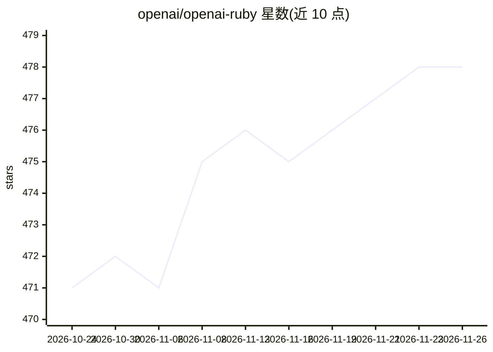

# openai/openai-ruby

⭐ 478 · Ruby · Apache-2.0 · 推送 2026-11-25 · [GitHub](https://github.com/openai/openai-ruby) · 组织维护

**Ruby 开发者接入 OpenAI REST API 的官方 SDK**

面向 Ruby 3.3.0+ 应用的官方 SDK，封装 OpenAI REST API 调用。提供完整类型定义（Yard/RBS/RBI，支持 Sorbet），默认以标准库 net/http 作传输层并带连接池。功能覆盖流式响应（SSE）、Chat Completions 工具自动运行器、Agents 会话（beta）、Realtime 与 Responses WebSocket、自动分页、文件上传与轮询、向量库批处理，以及自定义 HTTP 客户端与 mTLS 接入。通过 Bundler/Gemfile 安装。

## 筛选速览

| 维度 | 判定 | 备注 |
|---|---|---|
| AI 角色 | `ai-ecosystem` | LLM/agent 周边工具 |
| 许可风险 | `permissive` | Apache-2.0 |
| 部署形态 | `None` |  |
| 模型依赖 | — | README 未给出锁定关系 |
| 硬件要求 | — | 无带数字的原话,不猜 |
| 安装摩擦 | `low` | 无编译、无系统依赖或容器化 |
| 成熟度 | — | 结构信号不足 |

## 能力要点

- 流式响应（SSE）与 Realtime/Responses WebSocket 会话支持
- chat.completions.run_tools 工具回调自动运行器（校验、max_rounds、幂等键管理）
- 完整类型定义（Yard/RBS/RBI）与自动分页迭代器
- 可注入自定义 HTTP 客户端，支持 mTLS

## 适用场景

- 在 Ruby 应用中调用 OpenAI 模型生成文本与流式输出
- 为对话应用实现函数工具调用循环
- 搭建服务端实时语音/转录 WebSocket 会话
- 批量上传文件并轮询处理结果、写入向量库

## 场景标签

 · 领域:LLM 基础设施/SDK

## 证据(README 行号)

> L3: The OpenAI Ruby library provides convenient access to the OpenAI REST API from any Ruby 3.3.0+ application. It ships
> L11: ## Installation

## 星数曲线

2026-10-24 471 → 2026-11-26 478（+7）

---
*卡片 v1 · prompt 1.4 · 生成 2026-11-26 · 置信度 high · 依据 README sha `da645a260b9d` · [字段定义](../../DATASET.md)*
