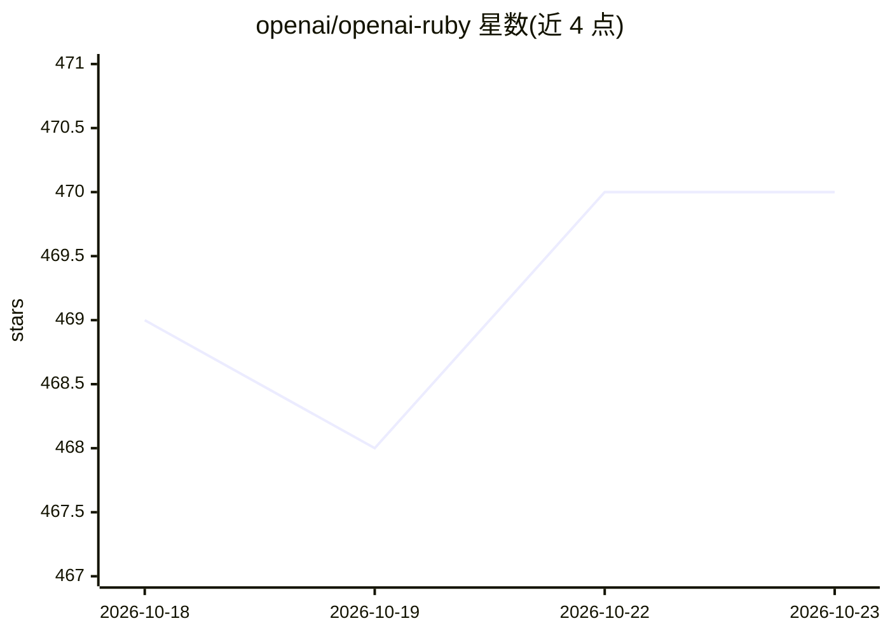

# openai/openai-ruby

⭐ 470 · Ruby · Apache-2.0 · 推送 2026-10-22 · [GitHub](https://github.com/openai/openai-ruby) · 组织维护

**OpenAI API 官方 Ruby SDK，供 Ruby 应用接入**

OpenAI 官方维护的 Ruby 3.3.0+ 客户端库，通过 Gemfile/Bundler 安装，以标准库 net/http 为传输层并用 connection_pool 做连接池。覆盖 Responses、Chat Completions（含工具调用的 run_tools 自动执行器）、Agents（beta，结构化输出）、Realtime/Responses WebSocket、文件上传与向量化存储轮询、分页迭代等 API；提供 Yard/RBS/RBI 类型与 Sorbet 支持，支持自定义 HTTP 客户端与 mTLS。部分能力为 beta 或需可选 gem（如 async-websocket）。

## 筛选速览

| 维度 | 判定 | 备注 |
|---|---|---|
| AI 角色 | `ai-ecosystem` | LLM/agent 周边工具 |
| 许可风险 | `permissive` | Apache-2.0 |
| 部署形态 | `None` |  |
| 模型依赖 | — | README 未给出锁定关系 |
| 硬件要求 | — | 无带数字的原话,不猜 |
| 安装摩擦 | `low` | 无编译、无系统依赖或容器化 |
| 成熟度 | — | 结构信号不足 |

## 能力要点

- Chat Completions 工具调用自动执行器 run_tools，含轮次与 tool_choice 校验
- Realtime WebSockets 支持（需可选 async-websocket gem），覆盖文本、转录、语音与 WebRTC/SIDEBAND
- 文件上传、处理轮询与 vector store 批量摄取助手
- 自动分页迭代器与自定义 HTTP 客户端契约

## 适用场景

- Ruby 应用中调用 OpenAI 的模型与 Responses/Chat API
- 在 Ruby 项目里接入 Realtime 实时语音/转录会话
- 上传文件并等待向量化存储处理完成
- 用自定义 HTTP 客户端接入代理、mTLS 等传输层配置

## 场景标签

 · 领域:LLM 基础设施/API 客户端

## 证据(README 行号)

> L1: # OpenAI Ruby API library
> L3: The OpenAI Ruby library provides convenient access to the OpenAI REST API from any Ruby 3.3.0+ application. It ships

## 星数曲线

2026-10-18 469 → 2026-10-23 470（+1）

---
*卡片 v1 · prompt 1.4 · 生成 2026-10-21 · 置信度 high · 依据 README sha `3e119c016521` · [字段定义](../../DATASET.md)*
