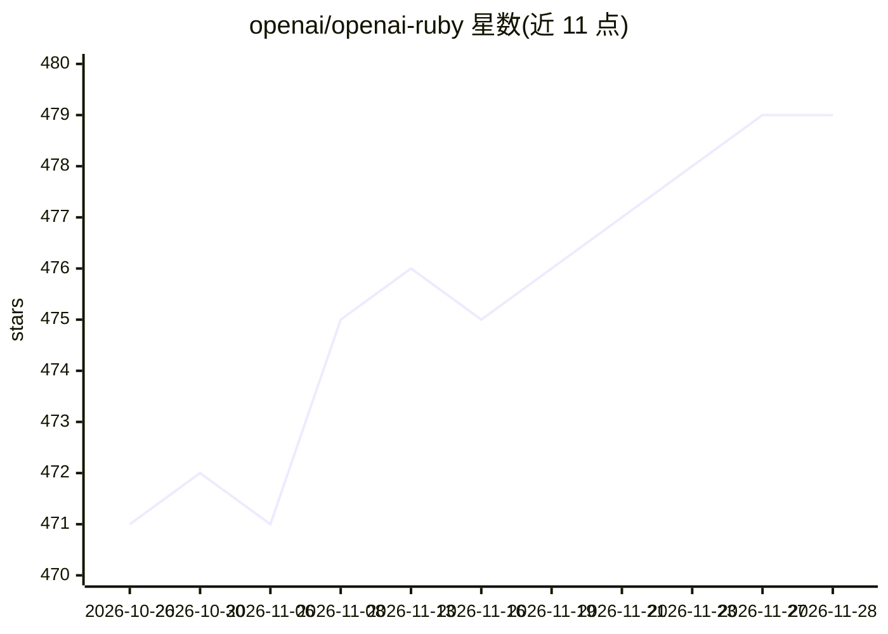

# openai/openai-ruby

⭐ 479 · Ruby · Apache-2.0 · 推送 2026-11-26 · [GitHub](https://github.com/openai/openai-ruby) · 组织维护

**Ruby 应用接入 OpenAI REST API 的官方 SDK**

面向 Ruby 3.3.0+ 应用的 OpenAI REST API 官方客户端库，通过 Bundler 安装。提供带类型定义（Yard/RBS/RBI/Sorbet）的 API 封装，覆盖流式响应（SSE）、Chat Completions 工具自动执行循环、Agents 会话（beta，含结构化输出解析）、Realtime 与 Responses WebSocket 会话、自动分页、文件上传与轮询、向量存储批量摄取、自定义 HTTP 客户端与 mTLS。HTTP 传输默认使用标准库 net/http，WebSocket 需可选安装 async-websocket gem。

## 筛选速览

| 维度 | 判定 | 备注 |
|---|---|---|
| AI 角色 | `ai-ecosystem` | LLM/agent 周边工具 |
| 许可风险 | `permissive` | Apache-2.0 |
| 部署形态 | `None` |  |
| 模型依赖 | locked-api |  |
| 硬件要求 | — | 无带数字的原话,不猜 |
| 安装摩擦 | `low` | 无编译、无系统依赖或容器化 |
| 成熟度 | — | 结构信号不足 |

## 能力要点

- Chat Completions 工具自动执行循环（run_tools），含校验与轮次控制
- Realtime 与 Responses 的 WebSocket 会话支持
- 自动分页迭代器与文件处理轮询助手
- 带 Yard/RBS/RBI 类型定义，支持 Sorbet

## 适用场景

- 在 Ruby 应用中调用 OpenAI 的对话、微调、文件等 API
- 构建需要函数工具调用的对话流程
- 建立服务端实时语音/转录 WebSocket 会话
- 批量上传文件并摄取到向量存储

## 场景标签

 · 领域:LLM 基础设施/SDK

## 证据(README 行号)

> L3: The OpenAI Ruby library provides convenient access to the OpenAI REST API from any Ruby 3.3.0+ application. It ships
> L11: ## Installation

## 星数曲线

2026-10-26 471 → 2026-11-28 479（+8）

---
*卡片 v1 · prompt 1.4 · 生成 2026-11-27 · 置信度 high · 依据 README sha `814b5340ba71` · [字段定义](../../DATASET.md)*
