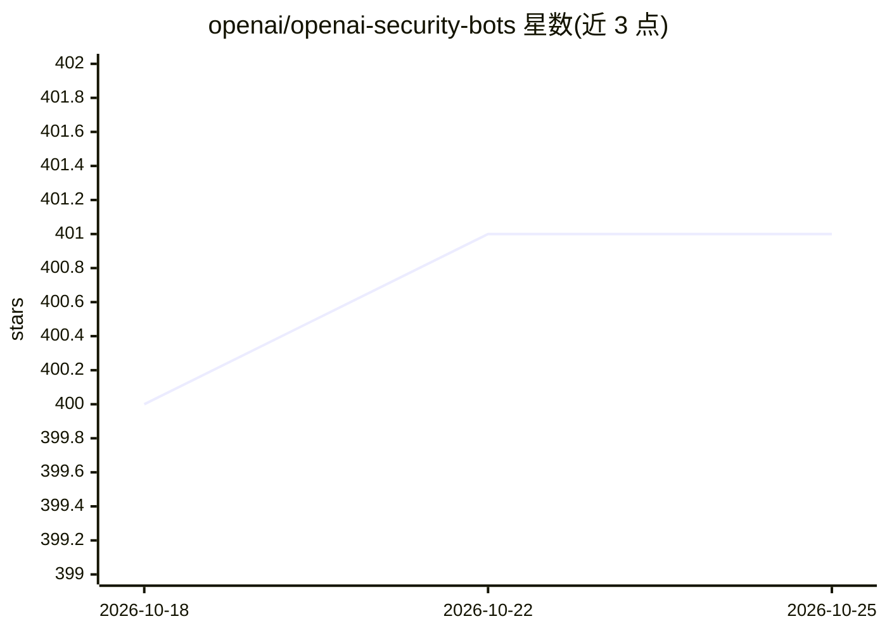

# openai/openai-security-bots

⭐ 402 · Python · MIT · 推送 2026-04-15 · [GitHub](https://github.com/openai/openai-security-bots) · 组织维护

**OpenAI 官方的 Slack 安全团队机器人集合**

OpenAI 维护的开源仓库，提供一组接入 OpenAI API 的 Slack 机器人，用于安全团队的工作流。仓库含共享库 shared/openai-slackbot 与三个机器人：triage（分诊）、incident-response（事件响应）、sdlc（软件开发生命周期）。README 仅给出目录结构与贡献流程，各机器人的具体功能与配置需查阅各自子目录的 README。贡献流程使用 pre-commit，通过 pip 安装。

## 筛选速览

| 维度 | 判定 | 备注 |
|---|---|---|
| AI 角色 | `ai-native` | 本体是模型或模型工具 |
| 许可风险 | `permissive` | MIT |
| 部署形态 | `library` | 以包/库形式分发 |
| 模型依赖 | — | README 未给出锁定关系 |
| 硬件要求 | — | 无带数字的原话,不猜 |
| 安装摩擦 | `low` | 无编译、无系统依赖或容器化 |
| 成熟度 | — | 结构信号不足 |

## 能力要点

- 提供 triage、incident-response、sdlc 三个 Slack 安全机器人
- 共享 openai-slackbot 基础库
- 使用 pre-commit 管理贡献规范

## 适用场景

- 安全团队在 Slack 中通过 AI 机器人辅助工单分诊
- 事件响应流程中调用 OpenAI API 辅助处理
- SDLC 环节集成 AI 辅助

## 场景标签

`网络安全` · 领域:学习与行业

## 证据(README 行号)

> L3: Slack bots integrated with OpenAI APIs to streamline security team's workflows.

## 星数曲线

2026-10-18 400 → 2026-10-25 401（+1）

---
*卡片 v1 · prompt 1.4 · 生成 2026-10-21 · 置信度 low · 依据 README sha `7143223ee0ff` · [字段定义](../../DATASET.md)*
