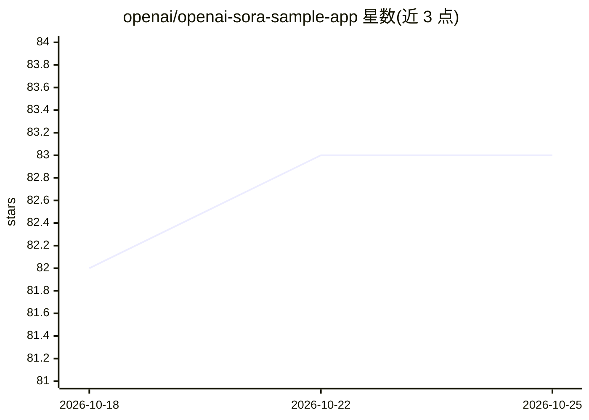

# openai/openai-sora-sample-app

⭐ 83 · TypeScript · MIT · 推送 2025-12-16 · [GitHub](https://github.com/openai/openai-sora-sample-app) · 组织维护

**基于 Sora Video API 的 NextJS 视频生成示例应用**

OpenAI 官方维护的 NextJS 示例应用，构建于 Sora Video API 与 OpenAI SDK 之上。提供文本提示词与可选图片输入生成、混剪视频的界面：一次提交多版本变体并轮询进度、自动优化提示词、用 gpt-image-1 生成参考图、预览/下载/重试已完成任务并将历史存于 localStorage。作为构建 Sora 视频体验的起点供开发者定制。Sora API 目前为受限访问，需通过 OpenAI 账户团队或候补名单申请。

## 筛选速览

| 维度 | 判定 | 备注 |
|---|---|---|
| AI 角色 | `ai-ecosystem` | LLM/agent 周边工具 |
| 许可风险 | `permissive` | MIT |
| 部署形态 | `library` | 以包/库形式分发 |
| 模型依赖 | — | README 未给出锁定关系 |
| 硬件要求 | — | 无带数字的原话,不猜 |
| 安装摩擦 | `low` | 无编译、无系统依赖或容器化 |
| 成熟度 | `idea` | |

## 能力要点

- 文本/图片输入生成与混剪视频，一次排队多版本变体
- 调用 Responses API 自动优化提示词
- gpt-image-1 生成参考图并作为 input_reference 输入
- 运行历史与偏好持久化于 localStorage

## 适用场景

- 快速试用 Sora Video API 的生成与混剪流程
- 作为起点定制自己的 Sora 视频生成应用
- 对比多次生成与混剪结果并批量下载

## 场景标签

`视频生成` · 领域:内容生成

## 证据(README 行号)

> L7: This repository contains a NextJS sample app built on top of the Sora Video API and OpenAI SDK.
> L22: This app is meant to be used as a starting point to build Sora-powered video experiences that you can customize to 

## 星数曲线

2026-10-18 82 → 2026-10-25 83（+1）

---
*卡片 v1 · prompt 1.4 · 生成 2026-10-24 · 置信度 high · 依据 README sha `6d7efc172429` · [字段定义](../../DATASET.md)*
