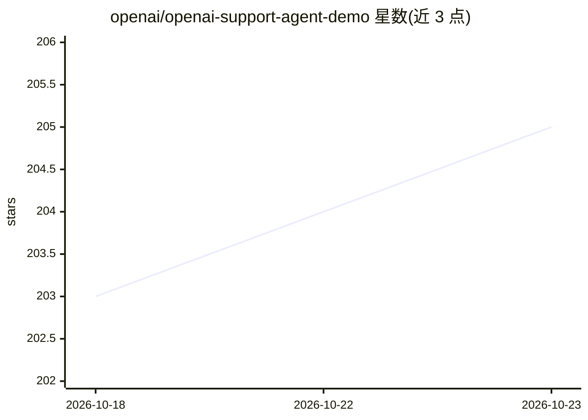

# openai/openai-support-agent-demo

⭐ 205 · TypeScript · NOASSERTION · 推送 2025-12-15 · [GitHub](https://github.com/openai/openai-support-agent-demo) · 组织维护

**OpenAI 官方演示：NextJS 客服 Agent，人工在环控制敏感操作**

基于 NextJS 与 OpenAI Responses API 构建的客服场景演示应用：AI agent 借助内置 File Search 工具检索知识库生成建议回复，界面分客户与人工客服两个视图；非敏感工具调用自动执行，敏感操作（如取消订单）以建议动作形式由人工确认后执行。使用需配置 OPENAI_API_KEY，通过 git clone、npm install 与 npm run dev 运行，首次需访问 /init_vs 初始化向量存储。README 声明演示中的函数为占位实现、不修改数据，且未做生产级安全措施（输入防护、用户认证等）。

## 筛选速览

| 维度 | 判定 | 备注 |
|---|---|---|
| AI 角色 | `ai-native` | 本体是模型或模型工具 |
| 许可风险 | `none` | NOASSERTION |
| 部署形态 | `library` | 以包/库形式分发 |
| 模型依赖 | — | README 未给出锁定关系 |
| 硬件要求 | — | 无带数字的原话,不猜 |
| 安装摩擦 | `low` | 无编译、无系统依赖或容器化 |
| 成熟度 | — | 结构信号不足 |

## 能力要点

- 客户/人工客服双视图聊天界面，人工在环确认敏感操作
- File Search 内置工具与向量存储创建、文件上传
- 流式建议回复与建议动作，非敏感工具调用自动执行
- 通过 config 目录文件自定义提示词、模型、函数与演示数据

## 适用场景

- 作为客服 AI 辅助人工场景的参考实现进行学习或定制
- 体验 Responses API 的 File Search 与 function calling 集成方式
- 以此为起点搭建自己的生产客服系统（需自行补齐安全措施）

## 场景标签

`聊天机器人` `RAG` · 领域:对话与助手

## 证据(README 行号)

> L7: This repository contains a NextJS demo app of a Customer Service with a Human in the loop (HITL) use case built on t
> L8: It leverages the file search built-in tool and implements 2 views of a chat interface: one for the customer, and one

## 星数曲线

2026-10-18 203 → 2026-10-23 205（+2）

---
*卡片 v1 · prompt 1.4 · 生成 2026-10-22 · 置信度 high · 依据 README sha `59b0047dba34` · [字段定义](../../DATASET.md)*
