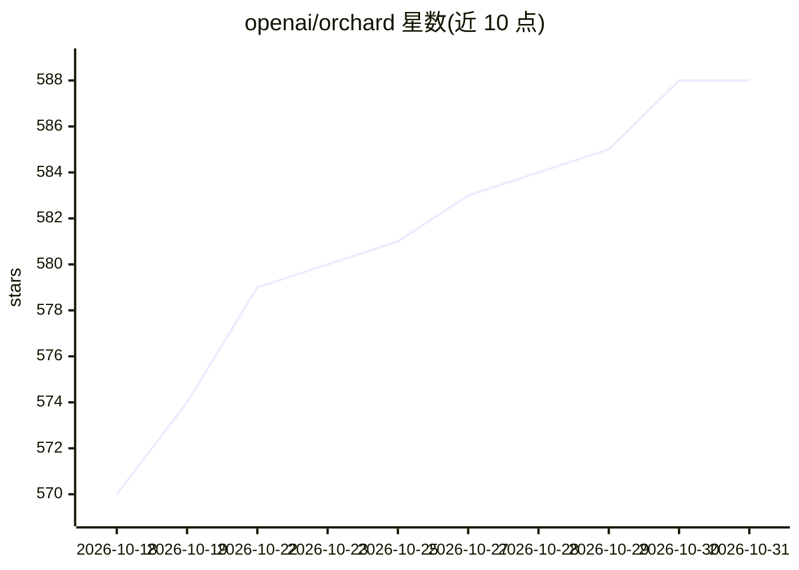

# openai/orchard

⭐ 588 · Go · NOASSERTION · 推送 2026-10-22 · [GitHub](https://github.com/openai/orchard) · 组织维护

**Apple Silicon 集群上编排 Tart 虚拟机的系统**

OpenAI 维护的 Tart 虚拟机编排系统：将多台裸机 Apple Silicon 机器组成集群，通过 Orchard Controller 与 Worker 架构管理数十台 VM。提供 orchard CLI 与内置 REST API 进行交互，支持本地开发模式（orchard dev 一键启动单机集群）。要求 macOS 15 (Sequoia) 及以上，针对新版 macOS 的 Local Network 权限弹窗给出两种规避方案（特权 helper 进程降权运行，或修改网络隐私配置后重启）。安装通过 Homebrew 完成。README 未提及任何 AI 相关功能。

## 筛选速览

| 维度 | 判定 | 备注 |
|---|---|---|
| AI 角色 | `ai-ecosystem` | LLM/agent 周边工具 |
| 许可风险 | `none` | NOASSERTION |
| 部署形态 | `None` |  |
| 模型依赖 | — | README 未给出锁定关系 |
| 硬件要求 | — | 无带数字的原话,不猜 |
| 安装摩擦 | `low` | 无编译、无系统依赖或容器化 |
| 成熟度 | — | 结构信号不足 |

## 能力要点

- Controller/Worker 架构管理 Apple Silicon 集群上的 Tart VM
- 提供 CLI 与内置 REST API 两种交互方式
- orchard dev 本地开发模式一键启动集群
- 针对 macOS Sequoia Local Network 权限的两种规避方案

## 适用场景

- 组建 Apple Silicon 裸机集群并批量管理 VM
- 为 CI 流水线提供 macOS 虚拟机资源池
- 本地单机快速试用 Orchard 集群功能

## 场景标签

 · 领域:基础设施/虚拟化编排

## 证据(README 行号)

> L26: Orchard is an orchestration system for Tart. Create a cluster of bare-metal Apple Silicon machines and manage dozen
> L39: You can interact with the newly created cluster using the `orchard` CLI or programmatically, through the built-in R

## 星数曲线

2026-10-18 570 → 2026-10-31 588（+18）

---
*卡片 v1 · prompt 1.4 · 生成 2026-10-21 · 置信度 low · 依据 README sha `39f341f2b167` · [字段定义](../../DATASET.md)*
