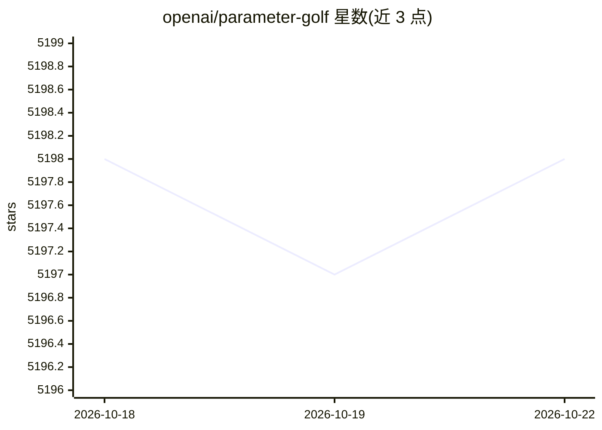

# openai/parameter-golf

⭐ 5,198 · Python · MIT · 推送 2026-10-02 · [GitHub](https://github.com/openai/parameter-golf) · 组织维护

**OpenAI 主办的极限小语言模型竞赛：16MB 内训练最优模型**

OpenAI Model Craft Challenge: Parameter Golf 是一项面向研究者的竞赛：在 16MB 模型产物、8xH100 上 10 分钟训练的约束下，以 FineWeb 验证集上的 bits per byte 压缩得分为评价指标，训练尽可能小的语言模型。README 提供排行榜（含无算力限制的 Non-record 提交区）、100 万美元算力资助申请表单、参与者登记表。竞赛周期为 3 月 18 日至 4 月 30 日，并关联 OpenAI 早期研究者招聘计划。

## 筛选速览

| 维度 | 判定 | 备注 |
|---|---|---|
| AI 角色 | `ai-knowledge` | 知识聚合/清单类 |
| 许可风险 | `permissive` | MIT |
| 部署形态 | `library` | 以包/库形式分发 |
| 模型依赖 | — | README 未给出锁定关系 |
| 硬件要求 | — | 无带数字的原话,不猜 |
| 安装摩擦 | `medium` | 含编译或系统依赖之一 |
| 成熟度 | — | 结构信号不足 |

## 能力要点

- 约束条件：16MB 模型产物、8xH100 训练 10 分钟内
- 以 tokenizer 无关的 FineWeb 验证集 bits per byte 计分
- OpenAI 赞助 100 万美元算力资助，可申请
- 排行榜含无算力限制的 Non-record 提交区

## 适用场景

- 研究者提交参数受限的语言模型训练方案并竞争排行榜名次
- 参考排行榜条目了解压缩、量化、测试时训练等技术组合
- 申请算力资助以参与小模型训练竞赛

## 场景标签

`模型训练` · 领域:训练与推理

## 证据(README 行号)

> L3: **OpenAI Model Craft Challenge: Parameter Golf** is a challenge to train the best language model that fits in a 16MB
> L28: |Run|Score|Author|Summary|Date|Info|

## 星数曲线

2026-10-18 5,198 → 2026-10-22 5,198（+0）

---
*卡片 v1 · prompt 1.4 · 生成 2026-10-20 · 置信度 mid · 依据 README sha `f60a5f089187` · [字段定义](../../DATASET.md)*
